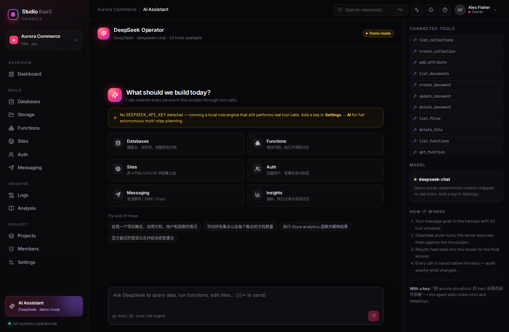
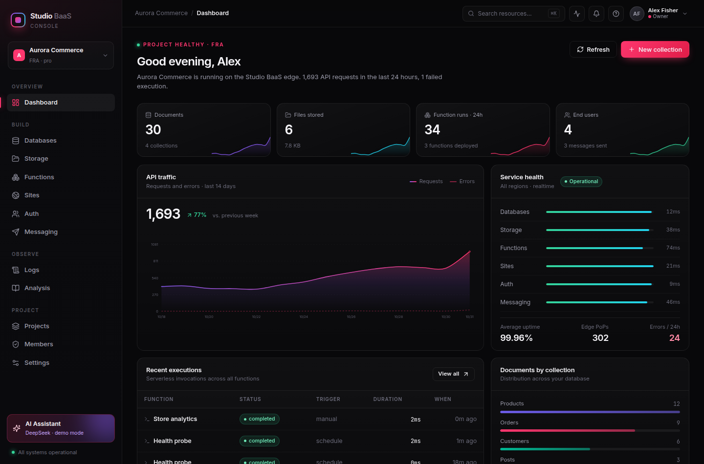
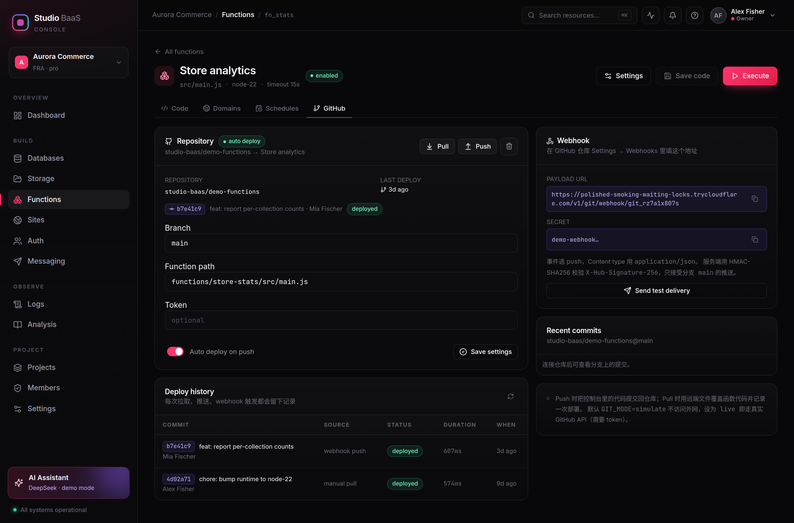

# Studio BaaS

**一个用 TypeScript 全栈实现的 BaaS 控制台**：多项目隔离、基于角色的权限、类型化数据库、对象存储、可在线编辑并执行的云函数（支持自定义域名、定时任务、GitHub 仓库部署）、可实时预览的站点托管、用户体系、消息通道，以及一个能用自然语言操作整套平台的 DeepSeek Agent。

[](./LICENSE)
[](https://www.typescriptlang.org/)
[](https://nodejs.org/)
[](https://react.dev/)
[](https://github.com/liudonghua123/studio-baas/pulls)


---

## 这是什么

把 Appwrite 那套「一个控制台收拢后端七件套」的体验，用 TypeScript 从零复刻了一遍：Express + SQLite 做服务端，React + Vite 做控制台，云函数跑在 Node `vm` 沙箱里，站点支持多文件在线编辑与 iframe 热预览，AI 助手通过 31 个工具**真实调用**平台 API 而不是只聊天。

资源都是**项目级**的：集合、存储桶、函数、站点、消息、API Key、日志、定时任务、域名、仓库绑定全部挂在 project 下，切换项目就切换整个上下文；每个项目再叠一层 RBAC（owner / admin / developer / viewer × 22 个权限点），人和 API Key 走同一套权限矩阵。

配套文档：

| 文档 | 内容 |
|---|---|
| [使用指南](./docs/使用指南.md) | 逐模块截图 + 操作步骤，23 张界面图 |
| [Appwrite 核心功能分析](./docs/Appwrite-核心功能分析.md) | 产品定位、架构、七大服务拆解、竞品对比、生产化差距（[PDF 版](./docs/Appwrite-核心功能分析.pdf)） |

## 核心交互

### 云函数：在线改代码，点一下就执行

左边 CodeMirror 写代码，右边填 JSON payload，点 **Run function** 同步执行，下方直接出响应体、日志、状态码与耗时；每次保存都会留版本，历史执行可回放。


函数里可以直接用注入的 `databases / storage / users / env`，示例函数会真实读写数据库：

```js
export default async ({ req, res, log, databases, env }) => {
  const { email, items = [] } = req.body || {};
  const total = items.reduce((s, i) => s + i.price * (i.qty || 1), 0);
  const doc = databases.createDocument('orders', { email, total, status: 'pending' });
  log('order created', doc.id, 'total', total);
  return res.json({ ok: true, orderId: doc.id, currency: env.CURRENCY || 'EUR' });
};
```

### 站点：改文件即热更新，右上角一键部署

文件树 + 编辑器 + iframe 三栏。编辑后 0.9s 自动保存并刷新预览，支持桌面/平板/手机三种视口，相对路径的 CSS/JS 会一并解析。


### 项目与权限：先选项目，再看身份

同一个控制台里可以并存多个项目（演示数据准备了 Aurora Commerce 与 Nebula Analytics），顶栏切换项目，所有列表、指标、日志随之切换。项目内可以邀请成员并分配角色，右上角还能「以某个角色预览」——立刻看到 viewer 的界面是什么样。


| 角色 | 典型能力 |
|---|---|
| **owner** | 项目设置、成员与角色、删除项目，全部读写 |
| **admin** | 除转让/删除项目外的全部读写，可管理成员 |
| **developer** | 数据库、存储、函数、站点的读写与执行，只读成员 |
| **viewer** | 只读：看集合、文档、代码、日志、指标 |

权限点共 22 个（`databases.read` / `functions.execute` / `members.write` …），API Key 的 scope 复用同一批 id —— 人机同权，`guard()` 中间件在路由层统一拦截，越权返回 403 并说明缺哪个权限点。


### 云函数：像 Appwrite 一样绑定域名、跑定时、连 GitHub

除了在线改代码，函数还具备三项生产环境常见能力：

**自定义域名**：填域名 → 拿到一条 TXT 校验记录 → 校验通过后自动签发（模拟）证书，之后按 `Host` 头把请求直接路由进函数。已生效的域名可以直接用 `curl -H 'Host: api.example.com'` 打到函数。


**定时任务**：手写的 5 段 cron 解析器（支持 `*`、列表、区间、步长），配合 IANA 时区，跨时区团队不会算错时间；输入时实时预览「接下来三次执行」。调度器每 15 秒扫描一次到期任务，执行记录与手动调用一样完整。


**GitHub 仓库**：绑定 `owner/repo@branch` 与入口文件路径，`Pull` 把远端代码写进函数并记录一次部署，`Push` 把控制台里的代码提交回分支；配置 webhook 后，向该分支 push 就会自动部署 —— 服务端用 HMAC-SHA256 校验 `X-Hub-Signature-256`，只接受目标分支的事件。默认 `GIT_MODE=simulate` 不访问外网即可演示全流程，设为 `live` 后走真实 GitHub API。


### AI 助手：31 个工具，覆盖全部服务



对话下方展示**工具轨迹**（名称、参数、结果、耗时）；没有 Key 时降级为本地规则引擎，仍然执行真实工具调用。

```text
你：执行 Store analytics 函数并解释结果
→ execute_function({"name":"Store analytics"})      1ms  ✓
← revenue 2770.45 / orders 9 / 库存告急 3 个 SKU
```

## 功能一览

| 模块 | 能力 |
|---|---|
| **Dashboard** | 文档/文件/函数/用户指标、14 天流量趋势、服务健康、最近执行、集合分布 |
| **Databases** | 集合与 9 种类型化属性、文档 CRUD、搜索分页、表单与 JSON 双模式编辑 |
| **Storage** | 多桶、扩展名白名单、体积限制、拖拽上传、图片预览、直链分享 |
| **Functions** | 在线编辑（CodeMirror 6）、保存版本、自定义 payload 执行、日志/响应/错误、环境变量、执行历史 |
| **Domains** | 自定义域名、TXT 校验、证书签发状态、Host 头路由、`DOMAIN_VERIFY_MODE` 真实校验 |
| **Schedules** | cron 解析与时区、未来三次执行预览、暂停/恢复、立即执行、执行状态回写 |
| **GitHub** | 仓库/分支/入口文件绑定、Pull/Push、webhook 验签与分支过滤、部署历史、最近提交 |
| **Projects** | 多项目隔离、项目切换、项目统计、级联删除 |
| **Members** | 4 种角色 × 22 个权限点、邀请/改角色/移除、以角色预览、权限矩阵 |
| **Sites** | 多文件在线编辑、iframe 实时预览、三档视口、防抖自动保存、部署与构建日志 |
| **Auth** | 用户 CRUD、active / unverified / blocked、标签、scrypt 密码、会话登录 |
| **Messaging** | Email / SMS / Push 统一发送与投递日志 |
| **Logs** | 请求日志 SSE 实时 tail、按服务与状态码过滤 |
| **AI Assistant** | DeepSeek 工具调用（31 个工具）、轨迹可视化、Demo 模式降级 |
| **Settings** | API Key 作用域管理、DeepSeek 配置、重置演示数据 |

## 快速开始

```bash
git clone git@github.com:liudonghua123/studio-baas.git
cd studio-baas
pnpm install
pnpm dev            # 控制台 http://localhost:5173 ，API :5174
```

生产模式（单端口，后端托管前端产物）：

```bash
pnpm build && pnpm start   # http://localhost:5174
```

首次启动自动建库并写入演示数据：2 个项目（**Aurora Commerce** 与 **Nebula Analytics**）、6 个集合、38 条文档、6 个文件、4 个云函数、3 个站点、6 位用户、7 条成员关系、定时任务、域名绑定与仓库部署记录，外加 14 天请求日志。删除 `server/data/` 即可重置。

## 公网访问

无需公网 IP 或端口映射，用 Cloudflare 快速隧道把本地实例映射成 HTTPS 域名：

```bash
curl -L https://github.com/cloudflare/cloudflared/releases/latest/download/cloudflared-linux-amd64 \
  -o /usr/local/bin/cloudflared && chmod +x /usr/local/bin/cloudflared

pnpm tunnel        # 开发模式（保留 HMR），隧道指向 :5173
pnpm tunnel:prod   # 生产模式，隧道指向 :5174
```

脚本会等到 `/v1/health` 返回 200 才打印地址，并写入 `.tunnel/url.txt`。页面、静态资源、API、函数执行、站点预览 iframe、Webhook 回调均已验证可穿透。

> **快速隧道不支持 SSE**：`*.trycloudflare.com` 会把 GET 响应整段缓冲到连接结束，所以 `/v1/realtime` 事件流在隧道下不会实时到达。控制台本身用轮询（Dashboard 20s、Logs 5s），隧道下功能完整；需要真实时流请改用命名隧道（`cloudflared tunnel --url` 以外的 `tunnel run` + 自有域名）。

设置好 GitHub 仓库的 Webhook 后，隧道域名也可以直接接收回调 —— 函数页里的 Payload URL 会自动使用当前访问域名，把 `https://<随机域名>.trycloudflare.com/v1/git/webhook/<id>` 填进 GitHub 即可，push 后控制台立即多一条部署记录。





## 配置 DeepSeek

```bash
export DEEPSEEK_API_KEY=sk-xxxxxxxx
export DEEPSEEK_MODEL=deepseek-chat    # 可选
```

或在 **Settings → AI operator** 中填写（环境变量优先）。未配置时进入 Demo 模式：规则引擎解析中文意图，照样执行真实工具调用，回复中会标注当前模式。

## 环境变量

完整清单见 [`.env.example`](./.env.example)：

| 变量 | 默认 | 作用 |
|---|---|---|
| `PORT` | `5174` | API 端口（生产模式下同时托管前端） |
| `DEEPSEEK_API_KEY` | — | 不配则进入 Demo 模式 |
| `DEEPSEEK_MODEL` | `deepseek-chat` | 模型名 |
| `DOMAIN_VERIFY_MODE` | `simulate` | `strict` 时用真实 DNS 查 TXT 记录 |
| `GIT_MODE` | `simulate` | `live` 时调用真实 GitHub REST API |

## 技术栈

- **前端**：React 18、Vite 6、TypeScript、CodeMirror 6、lucide-react、自研设计系统（无 UI 框架）
- **后端**：Node.js 22、Express 4、TypeScript、better-sqlite3（WAL）、multer
- **运行时**：Node `vm` 沙箱 + 模块白名单 + 超时控制，ESM 转译
- **实时**：SSE 事件总线（集合、文档、文件、函数、站点变更）
- **AI**：DeepSeek Chat Completions（OpenAI 兼容）+ Tool Calling，最多 6 轮规划

```
studio-baas/
├── docs/                      # 分析文档、使用指南、截图
├── scripts/tunnel.sh          # 开发服务 + Cloudflare Tunnel
├── server/src/
│   ├── index.ts               # Express 路由 + 静态托管
│   ├── db.ts                  # SQLite schema
│   ├── store.ts               # 业务服务层
│   ├── context.ts             # AsyncLocalStorage：请求级 projectId + principal
│   ├── projects.ts            # 项目管理与级联删除
│   ├── rbac.ts / members.ts   # 角色、权限点、成员关系
│   ├── auth.ts                # API Key / 会话 / 以角色预览 + guard()
│   ├── domains.ts             # 自定义域名与 DNS 校验
│   ├── cron.ts / schedules.ts # cron 解析、时区、调度器
│   ├── git.ts                 # GitHub 绑定、pull/push、webhook 验签
│   ├── runtime.ts             # 云函数沙箱
│   ├── ai.ts                  # DeepSeek harness + 工具注册
│   ├── seed.ts                # 演示数据
│   └── events.ts              # SSE 事件总线
└── web/src/
    ├── pages/                 # 各功能页面
    ├── components/            # Layout / CodeEditor / Charts / UI
    └── lib/                   # Markdown 渲染、格式化
```

## API 摘要

| 方法 | 路径 | 说明 |
|---|---|---|
| GET | `/v1/metrics` | 指标、趋势、服务健康 |
| GET/POST | `/v1/databases/collections` | 集合列表 / 创建 |
| GET/POST | `/v1/databases/collections/:id/documents` | 文档查询 / 创建 |
| PATCH/DELETE | `/v1/databases/collections/:id/documents/:docId` | 更新 / 删除 |
| POST | `/v1/storage/buckets/:id/files` | multipart 上传 |
| GET | `/v1/storage/files/:id/view` | 文件直链 |
| POST | `/v1/functions/:id/executions` | 执行函数（body 即 payload） |
| GET/PATCH | `/v1/functions/:id` | 读取 / 保存代码与环境变量 |
| GET/POST | `/v1/projects` | 项目列表 / 创建 |
| GET | `/v1/auth/me` | 当前身份、角色与权限点 |
| GET/POST | `/v1/members` | 成员列表 / 邀请 |
| GET/POST | `/v1/functions/:id/domains` | 域名绑定 / 列表 |
| POST | `/v1/functions/:id/domains/:domainId/verify` | DNS 校验并发证 |
| GET/POST | `/v1/functions/:id/schedules` | 定时任务 / 创建 |
| GET | `/v1/cron/preview?expr=&tz=` | 未来三次执行时间 |
| GET/POST | `/v1/functions/:id/git` | 仓库绑定 / 读取 |
| POST | `/v1/functions/:id/git/pull` `/push` | 拉取部署 / 提交回仓库 |
| POST | `/v1/git/webhook/:id` | GitHub webhook（HMAC 验签） |
| GET | `/v1/sites/:id/preview/*` | 站点预览 |
| POST | `/v1/sites/:id/deployments` | 部署 |
| GET/POST | `/v1/users` | 用户列表 / 创建 |
| POST | `/v1/messaging/messages` | 发送消息 |
| POST | `/v1/ai/chat` | AI 对话（含工具轨迹） |
| GET | `/v1/realtime` | SSE 事件流 |

## 安全说明

这是**本地演示实现**，不是生产级多租户平台 —— 但权限与项目隔离是真实生效的：

- 每个 `/v1` 请求都会解析出 `projectId` + `principal`，store 层查询按项目过滤，路由层用 `guard(permission)` 拦截，越权返回 403；
- 未提供任何凭据时按「演示 owner」放行，方便本地体验；接入真实登录后同一套守卫无需改动；
- 云函数使用 Node `vm` 沙箱，不构成强隔离边界，勿执行不可信代码；
- 文件存于本地 `server/data/uploads`，桶加密标记仅为元数据；
- API Key 明文展示，生产应哈希存储；GitHub token 只存服务端、不回传前端；
- 公网隧道是公开可访问的，演示完请关闭，且不要在公网实例里填真实 Key。

## License

[MIT](./LICENSE) © 2026 [liudonghua123](https://github.com/liudonghua123)
