# Studio BaaS

**一个用 TypeScript 全栈实现的 BaaS 控制台**：多项目隔离、基于角色的权限、类型化数据库、对象存储、可在线编辑并执行的云函数（支持自定义域名、定时任务、GitHub 仓库部署）、可实时预览的站点托管、用户体系、消息通道，以及一个能用自然语言操作整套平台的 DeepSeek Agent。

[](./LICENSE)
[](https://www.typescriptlang.org/)
[](https://nodejs.org/)
[](https://react.dev/)
[](https://github.com/liudonghua123/studio-baas/pulls)

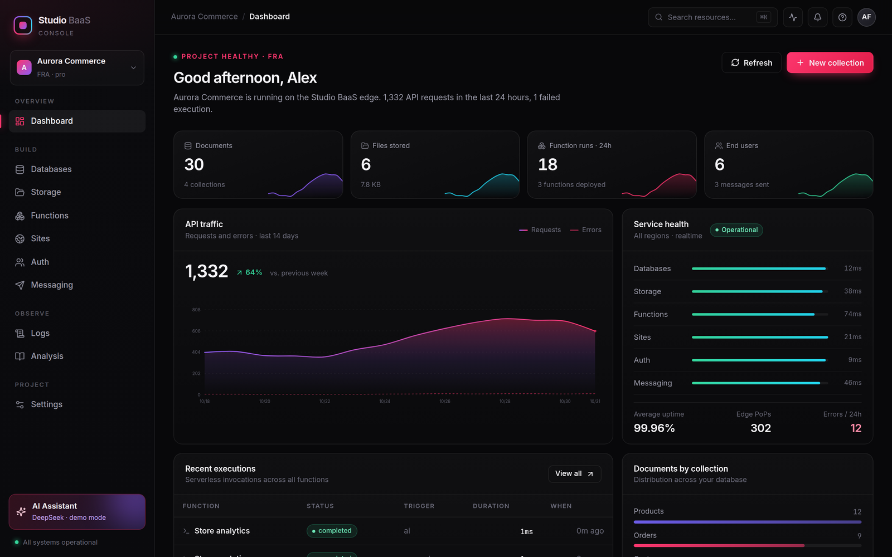

---

## 这是什么

把 Appwrite 那套「一个控制台收拢后端七件套」的体验，用 TypeScript 从零复刻了一遍：Express + SQLite 做服务端，React + Vite 做控制台，云函数跑在独立的 worker 线程里（内部仍是 `vm` 沙箱），站点支持多文件在线编辑与 iframe 热预览，AI 助手通过 48 个工具**真实调用**平台 API 而不是只聊天，写操作在执行前必须由人确认。

界面本身就是产品的一部分：**中英双语**（顶栏一键切换，英文原文即词条 key）与**亮/暗/跟随系统**三档主题，靠一套 CSS 语义变量撑着；切换不刷新页面，也不动你的数据。

资源都是**项目级**的：集合、存储桶、函数、站点、消息、API Key、日志、定时任务、域名、仓库绑定全部挂在 project 下，切换项目就切换整个上下文；每个项目再叠一层 RBAC（owner / admin / developer / viewer × 22 个权限点），人和 API Key 走同一套权限矩阵。

配套文档：

| 文档 | 内容 |
|---|---|
| [使用指南](./docs/使用指南.md) | 逐模块截图 + 操作步骤，23 张界面图 |
| [体验报告与差距分析](./docs/体验报告与差距分析.md) | 73 条 API 断言 + 15 页界面走查，逐项对照 Appwrite，含缺陷清单与路线图 |
| [Appwrite 核心功能分析](./docs/Appwrite-核心功能分析.md) | 产品定位、架构、七大服务拆解、竞品对比、生产化差距（[PDF 版](./docs/Appwrite-核心功能分析.pdf)） |

## 核心交互

### 云函数：在线改代码，点一下就执行

左边 CodeMirror 写代码，右边填 JSON payload，点 **Run function** 同步执行，下方直接出响应体、日志、状态码与耗时；每次保存都会留版本，历史执行可回放。

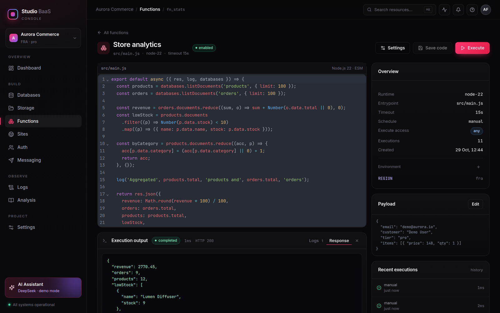

函数里可以直接用注入的 `databases / storage / users / env`，示例函数会真实读写数据库：

```js
export default async ({ req, res, log, databases, env }) => {
  const { email, items = [] } = req.body || {};
  const total = items.reduce((s, i) => s + i.price * (i.qty || 1), 0);
  const doc = databases.createDocument('orders', { email, total, status: 'pending' });
  log('order created', doc.id, 'total', total);
  return res.json({ ok: true, orderId: doc.id, currency: env.CURRENCY || 'EUR' });
};
```

### 站点：改文件即热更新，右上角一键部署

文件树 + 编辑器 + iframe 三栏。编辑后 0.9s 自动保存并刷新预览，支持桌面/平板/手机三种视口，相对路径的 CSS/JS 会一并解析。

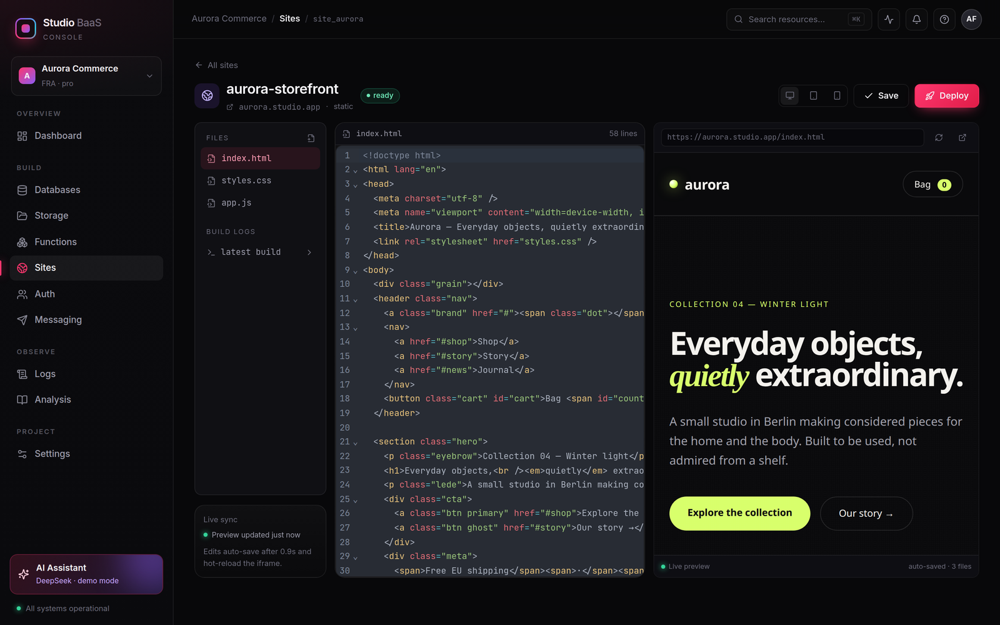

### 项目与权限：先选项目，再看身份

同一个控制台里可以并存多个项目（演示数据准备了 Aurora Commerce 与 Nebula Analytics），顶栏切换项目，所有列表、指标、日志随之切换。项目内可以邀请成员并分配角色，右上角还能「以某个角色预览」——立刻看到 viewer 的界面是什么样。

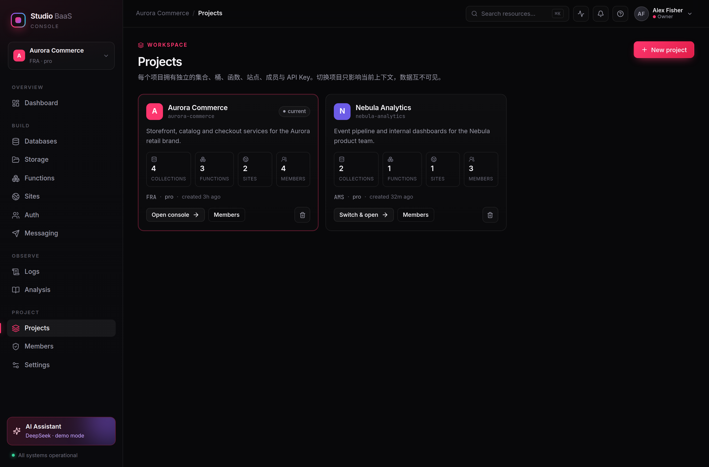

| 角色 | 典型能力 |
|---|---|
| **owner** | 项目设置、成员与角色、删除项目，全部读写 |
| **admin** | 除转让/删除项目外的全部读写，可管理成员 |
| **developer** | 数据库、存储、函数、站点的读写与执行，只读成员 |
| **viewer** | 只读：看集合、文档、代码、日志、指标 |

权限点共 22 个（`databases.read` / `functions.execute` / `members.write` …），API Key 的 scope 复用同一批 id —— 人机同权，`guard()` 中间件在路由层统一拦截，越权返回 403 并说明缺哪个权限点。

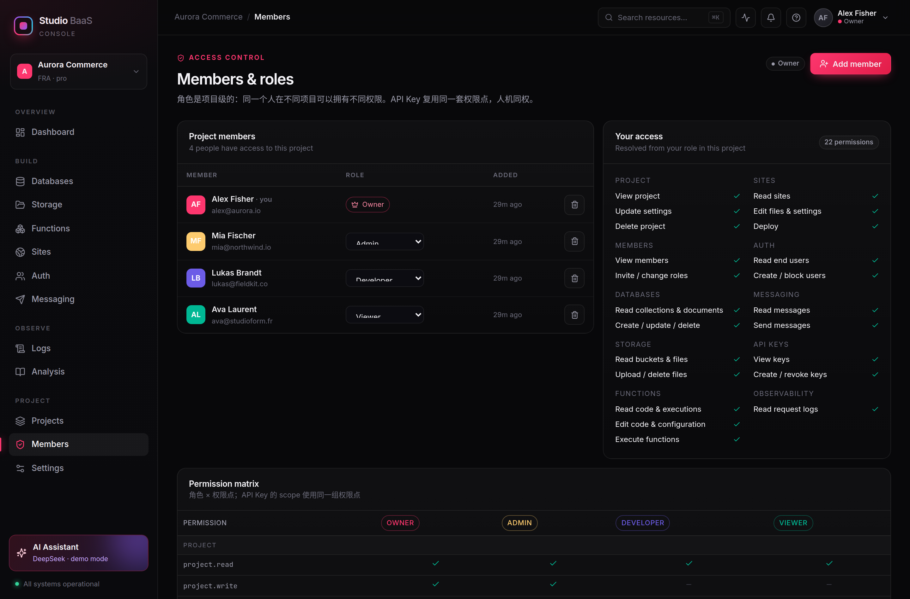

### 主题与语言：一套令牌撑两套皮肤

顶栏右侧的太阳/月亮按钮切主题，`EN`/`中` 切语言；**Settings → Appearance** 可以把偏好固定下来。首屏由 `index.html` 的内联脚本提前写入 `data-theme`，不会白闪；`localStorage` 记住选择，刷新和切项目都不丢。

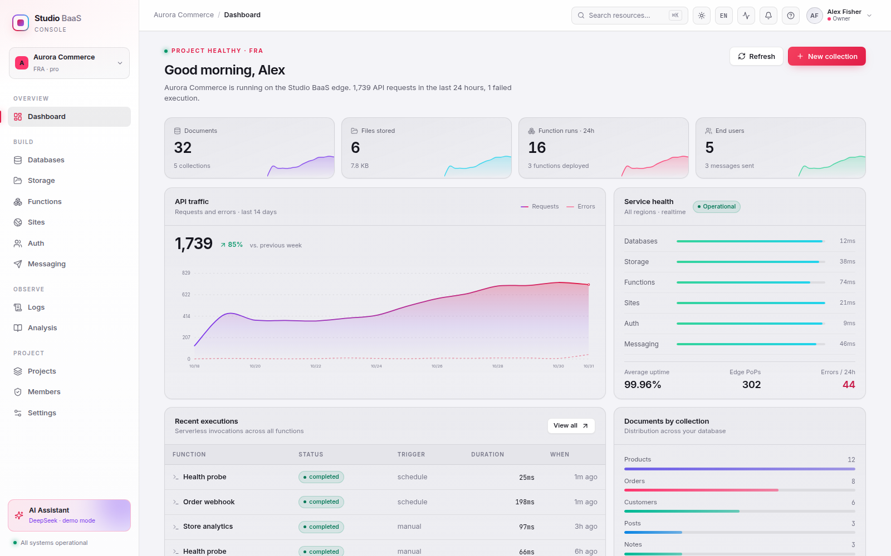

所有颜色走语义变量（`--bg` / `--panel` / `--line` / `--w1…w8` / 每类强调色的 text 变体），`:root[data-theme="light"]` 只覆盖变量值，组件里没有一行写死的深色。CodeMirror 在亮色下自动换成浅色高亮，图表 SVG 也跟着变量走。

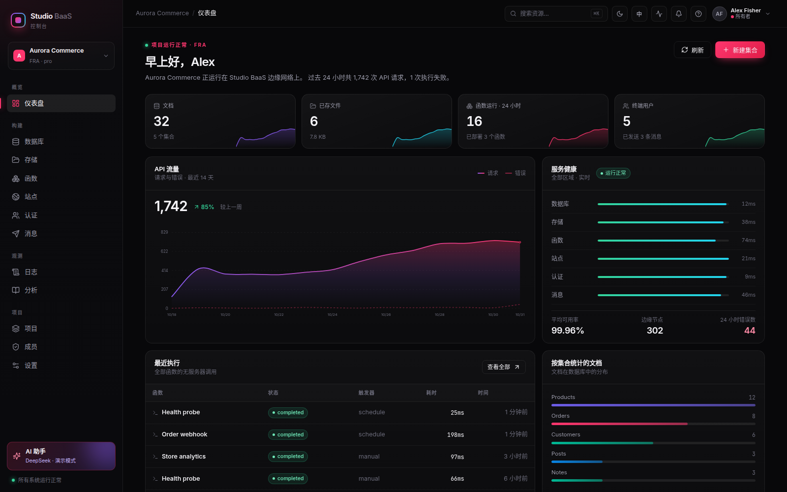

中文界面不是「整页贴一层翻译」，而是逐句挂词条：英文原文即 key（`t('New project')`），中文条目按页面拆在 `web/src/lib/i18n/zh.*.ts`，缺译回退英文而不是露出裸 key；日期与相对时间（`3m ago` ↔ `3 分钟前`）跟着语言走，字段名、代码、日志原文保持原样。

### 云函数：像 Appwrite 一样绑定域名、跑定时、连 GitHub

除了在线改代码，函数还具备三项生产环境常见能力：

**自定义域名**：填域名 → 拿到一条 TXT 校验记录 → 校验通过后自动签发（模拟）证书，之后按 `Host` 头把请求直接路由进函数。已生效的域名可以直接用 `curl -H 'Host: api.example.com'` 打到函数。

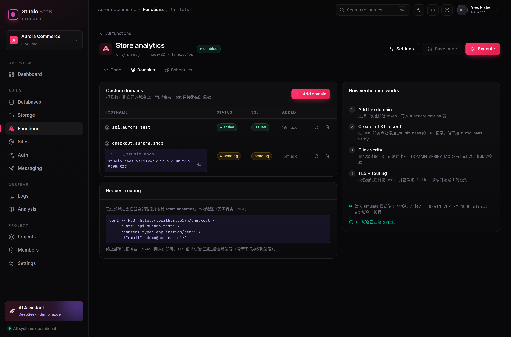

**定时任务**：手写的 5 段 cron 解析器（支持 `*`、列表、区间、步长），配合 IANA 时区，跨时区团队不会算错时间；输入时实时预览「接下来三次执行」。调度器每 15 秒扫描一次到期任务，执行记录与手动调用一样完整。

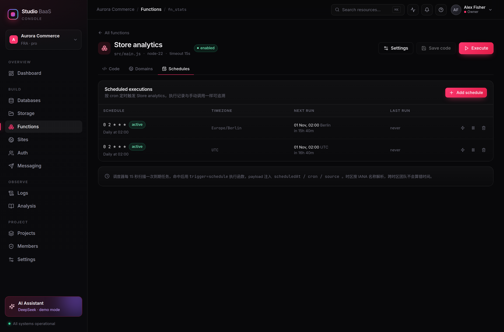

**GitHub 仓库**：绑定 `owner/repo@branch` 与入口文件路径，`Pull` 把远端代码写进函数并记录一次部署，`Push` 把控制台里的代码提交回分支；配置 webhook 后，向该分支 push 就会自动部署 —— 服务端用 HMAC-SHA256 校验 `X-Hub-Signature-256`，只接受目标分支的事件。默认 `GIT_MODE=simulate` 不访问外网即可演示全流程，设为 `live` 后走真实 GitHub API。

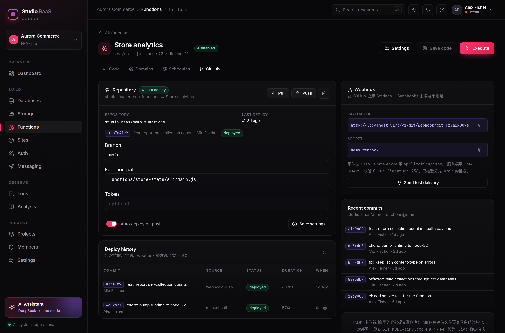

### AI 助手：48 个工具，写操作要人点头

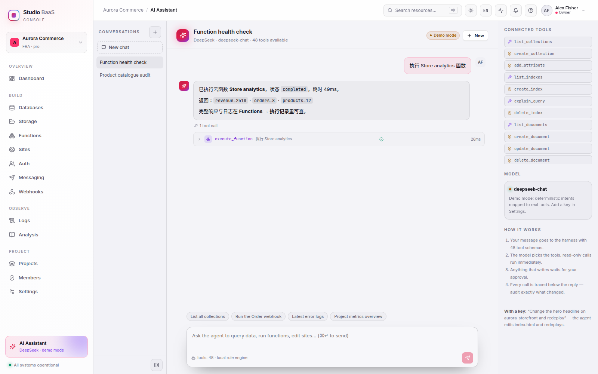

助手跑在一条**有审批关卡的 agent 循环**里：模型选工具 → 只读的立刻执行 → 要改数据的先停下来等人确认 → 结果回灌模型继续规划，最多 8 轮。回复是流式的，工具卡片会从转圈变成耗时与结果，不用等整段生成完。

- **会话持久化**：每个项目一份会话列表，刷新、切项目、换设备都还在；标题取首条消息，可重命名/删除。
- **审批**：`create_*` / `delete_*` / `update_*` / `deploy_*` / `execute_*` / `send_message` 等 28 个写工具默认挂起，前端弹出参数卡片，批准后从断点继续 —— 不会重新问模型，也就不会给出一个你没批准过的计划。
- **RBAC 不绕过**：工具清单按当前角色过滤，`viewer` 看不到也调不动删除类工具；demo 规则引擎走同一道闸。
- **多provider**：DeepSeek / OpenAI / Ollama / 任意 OpenAI 兼容网关，改 `AI_PROVIDER` 或 Settings 里的下拉即可，上层代码无感。
- **没 Key 也能用**：降级到本地规则引擎，仍然执行真实工具调用，只是规划能力有限。

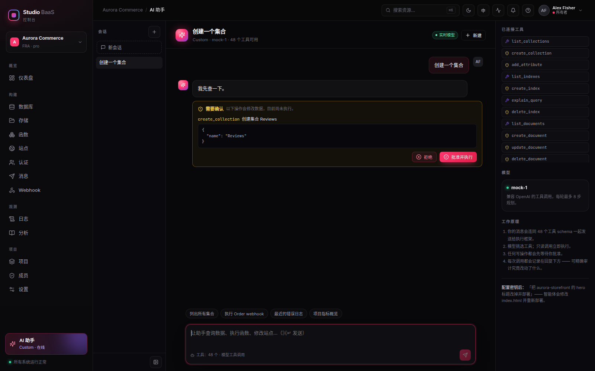

```text
你：执行 Store analytics 函数
→ execute_function({"function":"Store analytics"})   26ms  ✓
← revenue=2518 · orders=8 · products=12
```

### Webhooks：事件出站

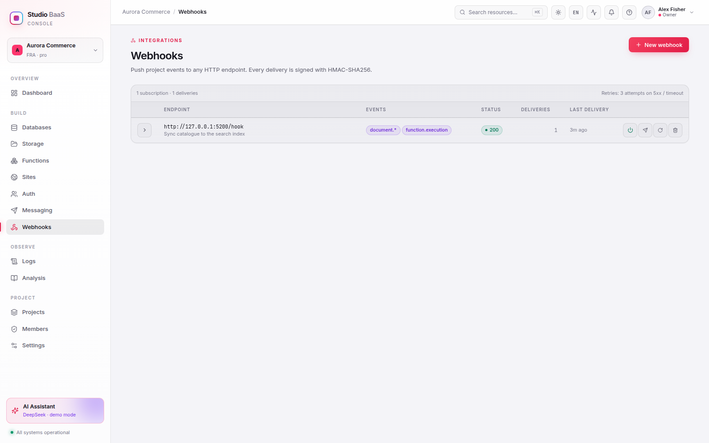

`document.*`、`function.*`、`site.*`、`user.*` 等事件可以订阅到任意 HTTP 端点。每次投递带 `X-Studio-Signature: t=<unix>,v1=<hmac>`（签名覆盖 `"{t}.{body}"`，防重放），5 秒超时，5xx 与超时最多重试 3 次，记录里能看到状态码、耗时与尝试次数。签名密钥只在创建/轮换时返回一次。

### 单点登录：把公司目录接到门口

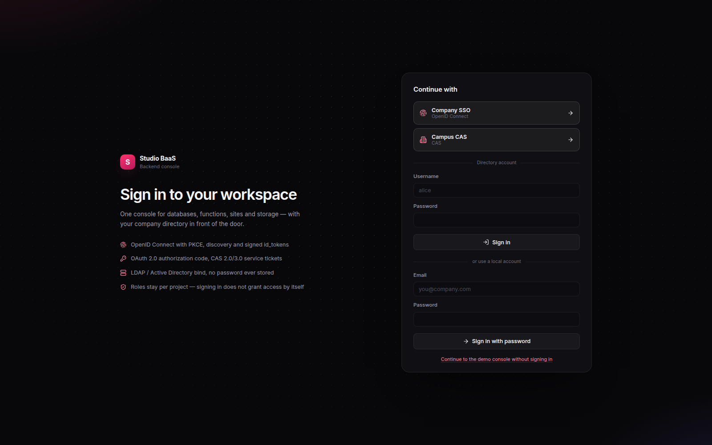

控制台登录页直接列出这个项目开好的身份源：点一下就走 IdP，回来已经是登录状态。四种协议共用一条落库路径（`issueSession`），所以密码登录和 SSO 登录的会话语义完全一致。

- **OIDC**：`discovery` 自动取端点与 JWKS，`id_token` 做 RS256/ES256 验签，校验 `iss` / `aud` / `exp` / `nonce`；支持 PKCE（S256）。
- **OAuth 2.0**：纯授权码流程，`userinfo` 取资料，`client_secret` 可放表单或 Basic。
- **CAS**：2.0 / 3.0 服务票据，`service` 逐字比对，ticket 一次性消费；3.0 的属性会映射成姓名与邮箱。
- **LDAP / AD**：先服务账号搜人，再**用这个人自己的 DN + 密码重新 bind**。空密码直接拒绝（否则等于匿名绑定），过滤器里的用户名按 RFC 4515 转义。

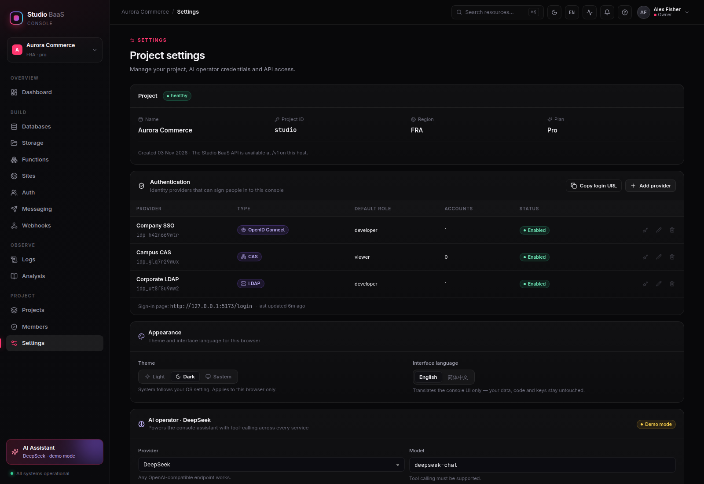

```bash
# 配置一个 OIDC 源（管理员权限）
curl -X POST localhost:5174/v1/auth/sso/config -H 'content-type: application/json' -d '{
  "type":"oidc","name":"Company SSO","defaultRole":"developer",
  "config":{"issuer":"https://keycloak.corp.example/realms/acme","clientId":"studio","clientSecret":"…"}
}'

# 拿授权地址（前端随后跳转），回调落在 /login#secret=…
curl -X POST localhost:5174/v1/auth/sso/<id>/start -H 'origin: http://localhost:5173' -d '{"returnTo":"/databases"}'
```

**安全默认值**：`state` 一次性、10 分钟过期，PKCE 自带，`redirect_uri` 与换取 token 时逐字一致；会话票据走 URL fragment（不进服务端日志、不外泄 Referer）；`clientSecret` / `bindPassword` 用 AES-256-GCM 加密落库，接口只回 `••••1234`；同邮箱并入已有账号**只在 IdP 声明 `email_verified` 时**发生；`returnTo` 只接受站内相对路径。

### 二次验证：TOTP、Passkey，按角色或按人强制

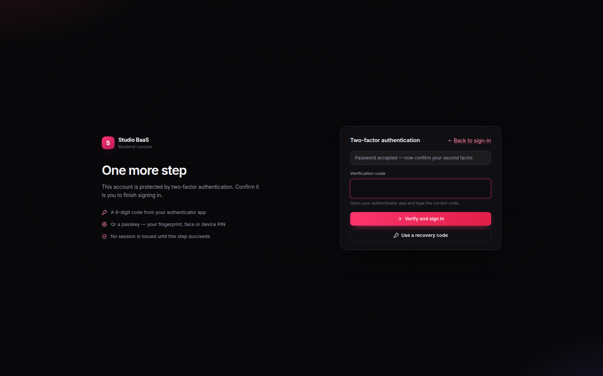

密码对了不代表能进。策略可以要求 `admin` / `owner`（或某个具体的人）在登录时再证明一次，方式有两种，也可以同时存在：

| 方式 | 实现 |
|---|---|
| **TOTP** | RFC 6238，SHA1 / 6 位 / 30 秒，允许 ±1 个步长的时钟漂移；同一个时间步的码只能用一次 |
| **Passkey** | WebAuthn，支持 P-256 / P-384 / P-521、RSA、Ed25519；CBOR、COSE、`authData` 全部自己解析，不引依赖 |
| **恢复码** | 绑定成功时发 10 个，sha256 存储，用掉即删；丢了手机还能进来 |

登录分成两步：第一因素（密码 / SSO / LDAP）通过后，服务端**不发会话**，只发一张 5 分钟的一次性挑战；第二因素过了才签发 `assurance=multi` 的会话。中间状态无法伪造——挑战 id 是 32 字节随机串，换不到任何业务接口。

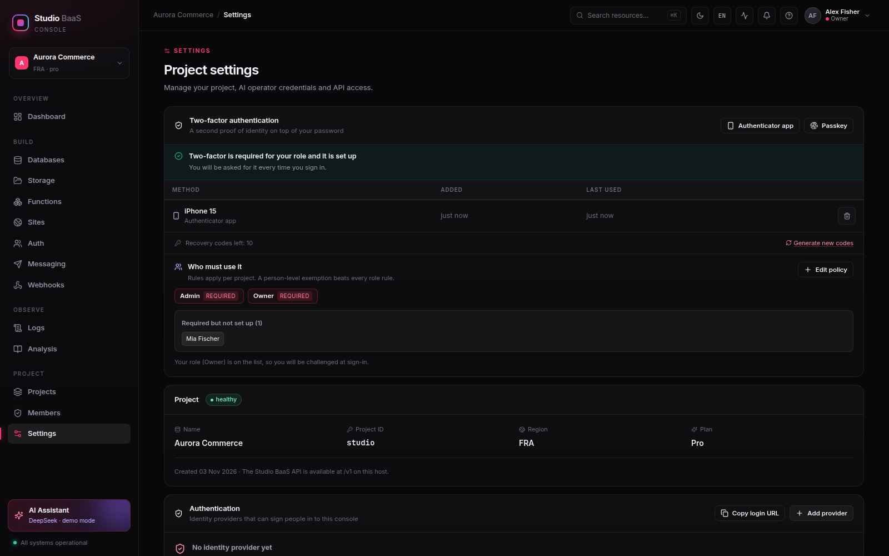

```bash
# 让所有 admin 必须开二次验证；某个服务账号豁免
curl -X PUT localhost:5174/v1/auth/mfa/policies -H 'content-type: application/json' -d '{
  "policies": [
    {"scope":"role","target":"admin","mode":"required"},
    {"scope":"user","target":"usr_ci_bot","mode":"exempt"}
  ]
}'
```

**强制注册的引导问题**：策略要求但这个人一个因素都没绑时，直接拒绝登录会把他永久锁在门外。所以这里发的是 `assurance=pending` 的受限会话：能打开设置页绑 TOTP / Passkey，**其他接口一律 403**。绑完还需要重新登录一次——否则「拿到密码的人自己绑一个认证器」就等于绕过了第二因素。

**边界**（都是测试逼出来的，不是设计时想到的）：

- 挑战只有 5 次机会，第 5 次之后整张挑战作废，必须重新走第一因素；
- TOTP 记录上次成功的步长，窗口内重叠的旧码不能用第二次；
- Passkey 校验 `signCount`，回退视为密钥被克隆；
- `rpId` 必须是域名——用 IP 访问时 Passkey 按钮直接不显示，服务端也会拒绝，而不是让浏览器抛一个看不懂的 `SecurityError`；
- 恢复码、TOTP secret 与身份源的密钥走同一套 AES-256-GCM 静态加密；删除用户时连带清理，避免 id 回收后新用户继承旧认证器。

## 功能一览

| 模块 | 能力 |
|---|---|
| **Dashboard** | 文档/文件/函数/用户指标、14 天流量趋势、服务健康、最近执行、集合分布 |
| **Databases** | 集合与 9 种类型化属性、文档 CRUD、**原子批量写入（≤500 行）**、Appwrite 风格 `queries[]` 过滤、文档级权限（`read("user:…")` / `team:…/role`）、**key/unique 索引 + EXPLAIN 查询计划**、表单与 JSON 双模式编辑 |
| **Storage** | 多桶、扩展名白名单、体积限制、拖拽上传、图片预览、直链分享 |
| **Functions** | 在线编辑（CodeMirror 6）、**每次保存即不可变版本 + 一键回滚**、自定义 payload 执行、**worker 线程隔离执行**、日志/响应/错误、环境变量、执行历史 |
| **Domains** | 自定义域名、TXT 校验、证书签发状态、Host 头路由、`DOMAIN_VERIFY_MODE` 真实校验 |
| **Schedules** | cron 解析与时区、未来三次执行预览、暂停/恢复、立即执行、执行状态回写 |
| **GitHub** | 仓库/分支/入口文件绑定、Pull/Push、webhook 验签与分支过滤、部署历史、最近提交 |
| **Projects** | 多项目隔离、项目切换、项目统计、级联删除 |
| **Members** | 4 种角色 × 22 个权限点、邀请/改角色/移除、以角色预览、权限矩阵 |
| **Sites** | 多文件在线编辑、iframe 实时预览、三档视口、防抖自动保存、部署与构建日志 |
| **Auth** | 用户 CRUD、active / unverified / blocked、标签、scrypt 密码、会话登录 |
| **2FA** | **TOTP（RFC 6238）、Passkey / WebAuthn、恢复码、按角色或按人的强制与豁免、半登录强制注册** |
| **SSO** | **OIDC（discovery + JWKS 验签 + PKCE）**、**OAuth 2.0**、**CAS 2.0/3.0**、**LDAP / AD bind**、登录页自动列源、连接测试、默认角色、邮箱域白名单 |
| **Messaging** | Email / SMS / Push 统一发送与投递日志 |
| **Logs** | 请求日志 SSE 实时 tail、按服务与状态码过滤 |
| **Webhooks** | 事件订阅、HMAC-SHA256 签名、失败重试、投递记录、密钥轮换 |
| **AI Assistant** | 48 个工具的 agent 循环、**流式输出**、**会话持久化**、**写操作审批**、轨迹可视化、多 provider、Demo 降级 |
| **Settings** | API Key 作用域管理（明文只返回一次，库里存 SHA-256）、**AI provider / 模型 / Base URL / 密钥**、**主题与语言偏好**、重置演示数据 |
| **Console** | **中英双语切换**、**亮/暗/跟随系统**主题、首屏无闪、日期与相对时间本地化、`pnpm i18n:check` 守门 |

## 快速开始

```bash
git clone git@github.com:liudonghua123/studio-baas.git
cd studio-baas
pnpm install
pnpm dev            # 控制台 http://localhost:5173 ，API :5174
```

生产模式（单端口，后端托管前端产物）：

```bash
pnpm build && pnpm start   # http://localhost:5174
```

首次启动自动建库并写入演示数据：2 个项目（**Aurora Commerce** 与 **Nebula Analytics**）、6 个集合、37 条文档、6 个文件、4 个云函数、3 个站点、7 位用户、7 条成员关系、3 个定时任务、1 个已生效域名（`api.aurora.test` → `Order webhook`）、1 个仓库绑定与 2 条部署记录，外加 14 天请求日志。删除 `server/data/` 即可重置。

## 公网访问

无需公网 IP 或端口映射，用 Cloudflare 快速隧道把本地实例映射成 HTTPS 域名：

```bash
curl -L https://github.com/cloudflare/cloudflared/releases/latest/download/cloudflared-linux-amd64 \
  -o /usr/local/bin/cloudflared && chmod +x /usr/local/bin/cloudflared

pnpm tunnel        # 开发模式（保留 HMR），隧道指向 :5173
pnpm tunnel:prod   # 生产模式，隧道指向 :5174
```

脚本会等到 `/v1/health` 返回 200 才打印地址，并写入 `.tunnel/url.txt`。页面、静态资源、API、函数执行、站点预览 iframe、Webhook 回调均已验证可穿透。

> **快速隧道不支持 SSE**：`*.trycloudflare.com` 会把 GET 响应整段缓冲到连接结束，所以 `/v1/realtime` 事件流在隧道下不会实时到达。控制台本身用轮询（Dashboard 20s、Logs 5s），隧道下功能完整；需要真实时流请改用命名隧道（`cloudflared tunnel --url` 以外的 `tunnel run` + 自有域名）。

设置好 GitHub 仓库的 Webhook 后，隧道域名也可以直接接收回调 —— 函数页里的 Payload URL 会自动使用当前访问域名，把 `https://<随机域名>.trycloudflare.com/v1/git/webhook/<id>` 填进 GitHub 即可，push 后控制台立即多一条部署记录。


## 配置 AI

默认走 DeepSeek，也可以换成任何 OpenAI 兼容端点：

```bash
export AI_PROVIDER=deepseek            # deepseek | openai | ollama | custom
export DEEPSEEK_API_KEY=sk-xxxxxxxx    # 或 OPENAI_API_KEY / AI_API_KEY
export AI_MODEL=deepseek-chat          # 可选，覆盖 provider 默认模型
export AI_BASE_URL=https://api.deepseek.com   # 可选，走网关时填
```

同样可以在 **Settings → AI operator** 里选服务商、填模型与 Base URL（环境变量优先）。Ollama 这类本地服务不需要密钥。

未配置时进入 Demo 模式：规则引擎解析中文意图，照样执行真实工具调用，回复中会标注当前模式。

## 环境变量

完整清单见 [`.env.example`](./.env.example)：

| 变量 | 默认 | 作用 |
|---|---|---|
| `PORT` | `5174` | API 端口（生产模式下同时托管前端） |
| `AI_PROVIDER` | `deepseek` | `deepseek` / `openai` / `ollama` / `custom` |
| `AI_BASE_URL` | provider 默认 | 覆盖端点，走网关时用 |
| `AI_MODEL` | provider 默认 | 覆盖模型名 |
| `DEEPSEEK_API_KEY` / `OPENAI_API_KEY` / `AI_API_KEY` | — | 任一存在即可；都没有则进入 Demo 模式 |
| `AI_APPROVAL` | `on` | 设为 `off` 时写操作不再请人确认（不建议） |
| `STUDIO_SECRET_KEY` | 自动生成 `data/.secret-key` | 加密 SSO 密钥的主密钥（32 字节 hex/base64，或口令派生） |
| `STUDIO_API_URL` | 由请求推断 | 反代后面用来拼 `redirect_uri` 的公网 API 地址 |
| `STUDIO_APP_URL` | 由请求 Origin 推断 | SSO 登录成功后的回跳地址 |
| `DOMAIN_VERIFY_MODE` | `simulate` | `strict` 时用真实 DNS 查 TXT 记录 |
| `GIT_MODE` | `simulate` | `live` 时调用真实 GitHub REST API |

## 技术栈

- **前端**：React 18、Vite 6、TypeScript、CodeMirror 6、lucide-react、自研设计系统（无 UI 框架，CSS 变量双主题 + 轻量 i18n 运行时）
- **后端**：Node.js 22、Express 4、TypeScript、better-sqlite3（WAL）、multer
- **运行时**：`worker_threads` 独立线程 + Node `vm` 沙箱 + 模块白名单 + 超时终止，ESM 转译
- **实时**：SSE 事件总线（集合、文档、文件、函数、站点变更）
- **AI**：OpenAI 兼容 Chat Completions（DeepSeek / OpenAI / Ollama / 自建网关）+ Tool Calling + SSE 流式，最多 8 轮规划，写操作带人工审批

```
studio-baas/
├── docs/                      # 分析文档、使用指南、截图
├── scripts/tunnel.sh          # 开发服务 + Cloudflare Tunnel
├── server/src/
│   ├── index.ts               # Express 路由 + 静态托管
│   ├── db.ts                  # SQLite schema
│   ├── store.ts               # 业务服务层
│   ├── context.ts             # AsyncLocalStorage：请求级 projectId + principal
│   ├── projects.ts            # 项目管理与级联删除
│   ├── rbac.ts / members.ts   # 角色、权限点、成员关系
│   ├── auth.ts                # API Key / 会话 / 以角色预览 + guard()
│   ├── domains.ts             # 自定义域名与 DNS 校验
│   ├── cron.ts / schedules.ts # cron 解析、时区、调度器
│   ├── git.ts                 # GitHub 绑定、pull/push、webhook 验签
│   ├── runtime.ts             # 云函数沙箱
│   ├── ai.ts                  # 工具注册 + 本地规则引擎
│   ├── agent/                 # provider 抽象、agent 循环、会话、权限映射
│   ├── webhooks.ts            # 事件订阅与签名投递
│   ├── secrets.ts             # AES-256-GCM 静态加密
│   ├── sso/                   # 身份源：providers / flow / routes / jwt / ldap / ber
│   ├── mfa/                   # 二次验证：totp / webauthn / cbor / policy / gate / routes
│   ├── seed.ts                # 演示数据
│   └── events.ts              # SSE 事件总线
└── web/src/
    ├── pages/                 # 各功能页面
    ├── components/            # Layout / CodeEditor / Charts / UI
    └── lib/                   # Markdown 渲染、格式化
```

## API 摘要

| 方法 | 路径 | 说明 |
|---|---|---|
| GET | `/v1/metrics` | 指标、趋势、服务健康 |
| GET/POST | `/v1/databases/collections` | 集合列表 / 创建 |
| GET/POST | `/v1/databases/collections/:id/documents` | 文档查询（支持 `queries[]`）/ 创建 |
| PATCH/DELETE | `/v1/databases/collections/:id/documents/:docId` | 更新 / 删除 |
| POST | `/v1/storage/buckets/:id/files` | multipart 上传 |
| GET | `/v1/storage/files/:id/view` | 文件直链 |
| POST | `/v1/functions/:id/executions` | 执行函数（body 即 payload） |
| GET/PATCH | `/v1/functions/:id` | 读取 / 保存代码与环境变量 |
| GET/POST | `/v1/projects` | 项目列表 / 创建 |
| GET | `/v1/auth/me` | 当前身份、角色与权限点 |
| GET/POST | `/v1/members` | 成员列表 / 邀请 |
| GET/POST | `/v1/functions/:id/domains` | 域名绑定 / 列表 |
| POST | `/v1/functions/:id/domains/:domainId/verify` | DNS 校验并发证 |
| GET/POST | `/v1/functions/:id/schedules` | 定时任务 / 创建 |
| GET | `/v1/cron/preview?expr=&tz=` | 未来三次执行时间 |
| GET/POST | `/v1/functions/:id/git` | 仓库绑定 / 读取 |
| POST | `/v1/functions/:id/git/pull` `/push` | 拉取部署 / 提交回仓库 |
| POST | `/v1/git/webhook/:id` | GitHub webhook（HMAC 验签） |
| POST | `/v1/databases/collections/:id/documents/bulk` | 原子批量写入（≤500） |
| POST | `/v1/ai/chat/stream` | AI 对话（SSE：`meta` / `delta` / `tool` / `approval` / `done`） |
| POST | `/v1/ai/resume` | 批准后从断点继续 |
| GET/POST | `/v1/ai/sessions` | 会话列表 / 新建 |
| GET/PATCH/DELETE | `/v1/ai/sessions/:id` | 读取消息 / 重命名 / 删除 |
| GET/POST | `/v1/webhooks` | 事件订阅列表 / 创建 |
| POST | `/v1/webhooks/:id/test` `/rotate` | 测试投递 / 轮换密钥 |
| GET | `/v1/webhooks/:id/deliveries` | 投递记录 |
| GET | `/v1/sites/:id/preview/*` | 站点预览 |
| POST | `/v1/sites/:id/deployments` | 部署 |
| GET/POST | `/v1/users` | 用户列表 / 创建 |
| POST | `/v1/messaging/messages` | 发送消息 |
| POST | `/v1/ai/chat` | AI 对话（含工具轨迹） |
| GET | `/v1/auth/mfa` | 我的第二因素、恢复码余量与策略状态 |
| POST | `/v1/auth/mfa/totp/begin` `/confirm` | 绑定认证器 App（先出密钥，再用一次验证码确认） |
| POST | `/v1/auth/mfa/webauthn/begin` `/finish` | 注册 Passkey |
| POST | `/v1/auth/mfa/verify` | 登录第二步：TOTP / 恢复码换会话 |
| POST | `/v1/auth/mfa/webauthn/assert/begin` `/finish` | 登录第二步：Passkey 换会话 |
| GET/PUT | `/v1/auth/mfa/policies` | 强制 / 豁免规则（`mfa.read` / `mfa.write`） |
| GET | `/v1/auth/sso/providers` | 登录页：可用的身份源（只含 id/type/name） |
| GET/POST | `/v1/auth/sso/config` | 身份源列表 / 新增（`sso.read` / `sso.write`） |
| PATCH/DELETE | `/v1/auth/sso/config/:id` | 修改 / 删除（连带身份映射） |
| POST | `/v1/auth/sso/config/:id/test` | 测试连接（discovery / CAS 登录页 / LDAP bind） |
| POST | `/v1/auth/sso/:id/start` | 拿授权地址与 state |
| GET | `/v1/auth/sso/:id/callback` | IdP 回调 → 302 到 `/login#secret=…` |
| POST | `/v1/auth/sso/:id/login` | LDAP 用户名密码登录 |
| GET | `/v1/realtime` | SSE 事件流 |

## 安全说明

这是**本地演示实现**，不是生产级多租户平台 —— 但权限与项目隔离是真实生效的：

- 每个 `/v1` 请求都会解析出 `projectId` + `principal`，store 层查询按项目过滤，路由层用 `guard(permission)` 拦截，越权返回 403；
- 未提供任何凭据时按「演示 owner」放行，方便本地体验；携带了失效的会话 / Key 则返回 401，不会回退成 owner；
- 开启集合的 **document security** 后，`read("any" | "users" | "user:<id>" | "team:<id>/<role>")` 会在列表、单条读取、更新、删除四处生效；无 read 权限时单条返回 404，不泄漏存在性；
- 云函数跑在独立的 `worker_threads` 线程里，超时直接 `terminate()`，死循环不会再拖垮 API（仍是共享内核，不是容器级隔离）；
- API Key 只存 SHA-256 摘要，明文仅在创建响应里出现一次，列表只显示预览；
- SSO 的 `clientSecret` / `bindPassword` 以 AES-256-GCM 密文入库，密钥来自 `STUDIO_SECRET_KEY` 或 `data/.secret-key`（0600）；接口只返回「已配置 + 尾号」，编辑时留空表示不修改；
- 外部身份只在两种情况下并入已有账号：该 `(providerId, subject)` 之前绑定过，或 IdP 明确声明邮箱已验证且管理员开启了 `trustEmail` —— 否则一个同名邮箱就能接管本地管理员；
- 会话带 assurance 等级：`pending` 只能访问 `/v1/auth/mfa/*` 与 `/v1/auth/me`，其余接口 403；TOTP secret 与恢复码同样加密落库；
- 文件存于本地 `server/data/uploads`，桶加密标记仅为元数据；GitHub token 只存服务端、不回传前端；
- `x-studio-act-as`（View as role）仅供演示：无凭据时可声明任意角色；**带会话时只能往下看，不能自我提权**；公网部署建议 `STUDIO_ALLOW_ACT_AS=0` 关掉；
- 不带任何凭据的请求仍按「演示 owner」放行，这是本地体验的取舍——真要上线请把它改成 401；
- 公网隧道是公开可访问的，演示完请关闭，且不要在公网实例里填真实 Key。

## License

[MIT](./LICENSE) © 2026 [liudonghua123](https://github.com/liudonghua123)
