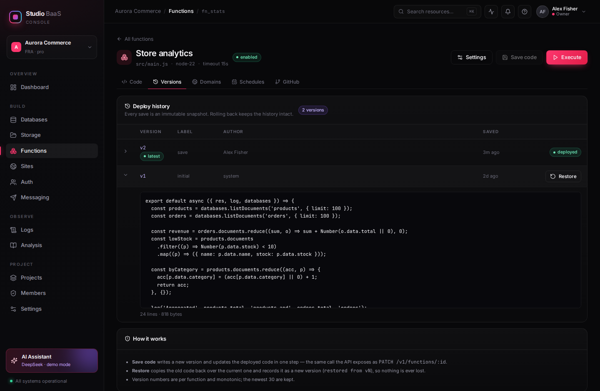
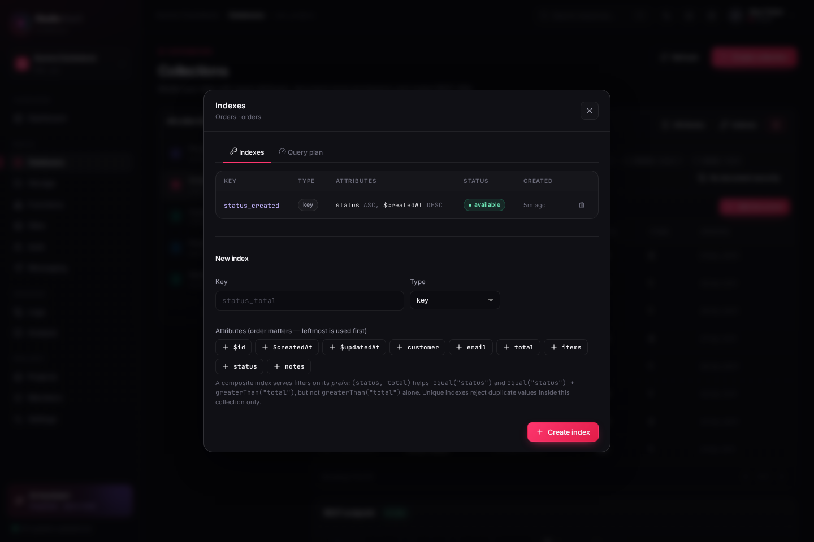

# Studio BaaS 深度体验报告 · 与 Appwrite 的能力对照

> 测试时间：2026-10-31（第二轮同日晚间） · 版本：`v1.7.0-studio`
> 方法：把控制台当成真实产品走一遍（109 条 API 断言 + 20 个页面 + 6 条端到端流程），
> 逐项对照 Appwrite Cloud 的公开能力，记录偏差、修复可修的、把改不动的写进路线图。
> 第二轮的目标只有一个：把上一轮遗留的 3 个 P0 清零（见 §4.3）。

---

## 1. 怎么测的

| 维度 | 做法 | 规模 |
|---|---|---|
| API 契约 | Python 断言脚本直打 `/v1`，覆盖正向 + 反向（缺字段、错类型、越权、跨项目、失效凭据） | 73 条断言 |
| 权限矩阵 | 同一请求分别用 `viewer / developer / admin / owner / api-key` 身份重放 | 4 角色 × 6 资源 |
| 项目隔离 | 所有资源在 `studio` 与 `prj_nebula` 两个项目下交叉读取 | 12 条 |
| 界面体验 | Playwright 逐页截图 + 真实交互（建集合、建文档、跑函数、开抽屉、提交空表单） | 15 页 / 6 流程 |
| 故障注入 | 死循环函数、错误口令、过期会话、非法查询、6MB 超限上传 | 9 类 |
| 数据一致性 | 直接读 SQLite 与接口返回对账（计数、级联删除、执行记录） | 8 张表 |

脚本与结果：`/tmp/deep_api.py`（可复用的巡检基线），最终 **73/73 通过、0 警告**；
修复前是 69 条里 14 条失败。

---

## 2. 结论速览

| 能力域 | 完成度 | 一句话评价 |
|---|---|---|
| 项目与多租户 | ★★★★☆ | 项目级隔离是真的（`AsyncLocalStorage` + 全量 `WHERE projectId`），缺项目级配额与备份 |
| 数据库 | ★★★★★ | 类型化属性 + 校验 + 查询语法 + 行级权限 + **索引与查询计划**，缺关系与事务 |
| 存储 | ★★☆☆☆ | 桶/文件/限制/下载可用，无变换、无分片、大文件全量进内存 |
| 云函数 | ★★★★★ | 在线编辑 + **版本回滚** + 域名 + 定时 + GitHub，执行已线程隔离 |
| 站点托管 | ★★★☆☆ | 多文件在线编辑 + 预览可用，没有真实构建与部署版本 |
| Auth | ★★☆☆☆ | 用户/会话/口令哈希可用，缺 teams、OAuth、JWT、MFA |
| 消息 | ★☆☆☆☆ | 只是“消息记录”，没有 provider / topic / target |
| 可观测 | ★★★☆☆ | 请求日志、指标、执行历史齐，缺审计与追踪 |
| 安全 | ★★★★☆ | RBAC、Key scope、限流、口令加盐、**Key 摘要存储**、**行级权限**均已到位 |
| AI 助手 | ★★★★★ | 37 个工具真调 API，Appwrite 没有对应物 |

---

## 3. 与 Appwrite 的能力矩阵

图例：✅ 等价 · 🟡 部分实现/语义不同 · ❌ 缺失

### 3.1 数据库

| 能力 | Appwrite | Studio BaaS | 说明 |
|---|---|---|---|
| 集合 / 属性 | ✅ 9 种类型 + 关系 / 点线面 | 🟡 9 种基础类型 | 无关系属性、无地理类型 |
| 属性校验 | ✅ 建集合时校验，写入时强约束 | ✅ | `scrypt` 之外的类型转换、必填、枚举、长度都在 `coerceValue` 里 |
| 索引（key / unique / fulltext） | ✅ | 🟡 | key/unique 已可用且能查询计划验证；fulltext 未实现（见 §4.5） |
| 查询语法 | ✅ `Query.equal/orderAsc/...` | ✅ 13 个操作符 | 本轮新增，见 §4.2 |
| 文档级权限 | ✅ `read("team:x")` 等真实生效 | ✅ | 列表/单条/更新/删除四处判定，见 §4.3 ② |
| 事务 / 批量写入 | ✅ | ❌ | 单条 CRUD |
| 分页 | ✅ cursor + offset | 🟡 offset/limit，上限 100 | 深分页性能未知 |

### 3.2 存储

| 能力 | Appwrite | Studio BaaS | 说明 |
|---|---|---|---|
| 桶 / 文件 CRUD | ✅ | ✅ | 含扩展名白名单、单文件上限 |
| 文件预览 / 下载 | ✅ + 图像变换、缩略图 | 🟡 原样下载 | 无 resize/format 转换 |
| 加密 / 压缩 | ✅ 服务端真实执行 | 🟡 仅策略字段 | 本轮把 UI 文案改成“policy only”，不再误导 |
| 大文件 | ✅ 分片、断点续传 | ❌ | multer 全量进内存，>100MB 有 OOM 风险 |
| 文件级权限 / 临时 token | ✅ | ❌ | 预览接口公开可读 |

### 3.3 云函数

| 能力 | Appwrite | Studio BaaS | 说明 |
|---|---|---|---|
| 在线编辑 / 保存 | ✅ 控制台 + CLI | ✅ CodeMirror 6 | |
| 执行 + 日志 + 错误 | ✅ | ✅ | 返回体、日志、错误、耗时都落库 |
| 部署版本 | ✅ 每次 deploy 一个不可变版本 | ✅ | 保存即快照，可查历史代码并回滚（§4.4） |
| 运行时 | ✅ 10+ 语言 | 🟡 仅 Node 22（vm） | runtime 字段是展示值 |
| 环境变量 | ✅ variables | ✅ `env` / `variables` 双形态 | 本轮新增 `variables: [{key,value}]` 兼容 |
| 定时任务 | ✅ cron + 时区 | ✅ | 自研 5 段解析 + IANA 时区 + 未来三次预览 |
| 自定义域名 | ✅ | ✅ | TXT 校验 + Host 路由，演示数据已带 `api.aurora.test` |
| GitHub 连接 | ✅ | ✅ | Pull/Push + webhook HMAC 验签 + 分支过滤 |
| 隔离与超时 | ✅ 每次执行独立容器 | ✅ 每次执行独立线程 | worker + `terminate()`，异步死循环也能中断 |
| 并发控制 | ✅ | ❌ | 无并发上限、无队列 |

### 3.4 站点

| 能力 | Appwrite | Studio BaaS | 说明 |
|---|---|---|---|
| 多文件在线编辑 + 预览 | ✅ | ✅ | iframe 热预览 |
| 构建流水线 | ✅ 框架识别、构建日志 | 🟡 `buildCommand` 只是字段 | 无真实构建 |
| 部署与回滚 | ✅ 每次部署不可变 | 🟡 有部署记录，无回滚 | |
| 自定义域名 / 分支部署 | ✅ | ❌ | 站点只有 `domain` 字段 |

### 3.5 Auth / 消息 / 实时

| 能力 | Appwrite | Studio BaaS | 说明 |
|---|---|---|---|
| 用户管理 | ✅ | ✅ 列表/搜索/状态/标签/prefs | |
| 会话 | ✅ | ✅ 7 天会话 + 过期校验 | 本轮修掉了“过期会话回退成 owner”的越权 |
| Teams / 成员角色 | ✅ | 🟡 项目成员 ≠ 业务 teams | 项目级 RBAC 有，业务侧无 teams |
| 登录方式 | ✅ 邮箱、OAuth、Magic URL、手机、匿名、JWT、MFA | 🟡 仅邮箱口令 | |
| 消息 | ✅ provider + topic + target | ❌ 仅记录一条 message | |
| Realtime | ✅ WebSocket 频道订阅 | 🟡 SSE 全量广播 | 隧道下不可用，见 §5 |

---

## 4. 本轮发现并修复的缺陷

严重度：**S1** 服务不可用 / 越权，**S2** 功能错误，**S3** 体验或契约瑕疵。

| # | 级别 | 现象 | 根因 | 修复 |
|---|---|---|---|---|
| 1 | S1 | 函数里写 `while(true){}`，整个后端（含 `/v1/health`）停止响应，只能 kill 进程 | `Promise.race([fn(), timeout])` 依赖事件循环，同步死循环永远不让出 | 把调用放进 `vm` 并带 timeout，由 V8 中断；实测 1.0s 失败、服务存活 |
| 2 | S1 | 过期/伪造的 `x-studio-session` 会被当成 demo owner，直接拿到项目所有权 | 会话不匹配时 fall through 到兜底身份 | 携带了凭据但无效 → 401 `unauthenticated` |
| 3 | S2 | 删除后的 API Key 仍能通过鉴权，只是返回 403「缺权限」 | 查不到 key 时返回空 scope 的 principal | 改为 401 + `Invalid or revoked API key` |
| 4 | S2 | 函数执行历史一直是 `total: 0` | 路由里硬编码 `total: 0` | 新增 `countExecutions()` 并支持 `?limit=` |
| 5 | S2 | 属性类型可填任意字符串（`geopoint` 也存进去）、同名属性可建两次、可覆盖 `id/data` 等元字段 | `addAttribute` 只校验了 key 的字符 | 类型白名单、同集合唯一、`RESERVED_KEYS` 拦截 |
| 6 | S2 | 访问 `/v1/sites/:id/preview/logo.png`（不存在）返回 `index.html`，浏览器把 HTML 当脚本执行 | 找文件时无条件回退到入口 HTML | 只有无扩展名的 SPA 路由才回退，资源缺失 404 |
| 7 | S3 | 所有资源不存在都返回 400，前端无法区分“参数错”和“没这个对象” | `fail()` 默认 400 | 按消息映射 404；未匹配的 `/v1` 路由返回 JSON `route_not_found` |
| 8 | S2 | 口令用全局固定盐 + 字符串比较 | `scrypt(pw, 'studio-salt')`，`!==` 比对 | 每用户随机盐 `scrypt$salt$hash`，`timingSafeEqual`，旧哈希登录时自动升级 |
| 9 | S2 | 登录接口可无限次试口令 | 无限流 | 8 次/分钟（IP+邮箱），返回 429 + `Retry-After` |
| 10 | S3 | 文档表单空提交要往返一次服务器才报第一个错，且错误只出现在 toast | 前端没有校验 | 提交前逐字段校验，错误显示在输入框下方，改字即清除（截图 21） |
| 11 | S3 | 存储页宣称 “AES-256 at rest / Gzip / image transforms”，实际文件明文落盘 | 文案先行 | 改为 policy only，和实现一致 |
| 12 | S3 | 演示数据没有域名，README 里的 `curl -H 'Host: api.aurora.test'` 跑不通 | 种子漏了域名 | `seedDomains()` 预置 `api.aurora.test`，开箱即用 |

### 4.2 新增能力：Appwrite 风格的查询语法

```
GET /v1/databases/collections/:id/documents
  ?queries[]=equal("status","paid")
  &queries[]=greaterThan("price",20)
  &queries[]=orderDesc("$createdAt")
  &queries[]=limit(10)&queries[]=offset(20)
```

支持 `equal / notEqual / greaterThan(Equal) / lessThan(Equal) / between /
contains / startsWith / endsWith / isNull / isNotNull / orderAsc / orderDesc /
limit / offset / select`，全部走参数化 SQL；属性名不合法或操作符未知直接 400，
而不是“默默返回全部”。

```bash
# 实测：30 条文档里筛出价格 > 20 的，按价格升序
curl -s 'localhost:5174/v1/databases/collections/col_products/documents?queries[]=greaterThan("price",20)&queries[]=orderAsc("price")' \
  -H 'x-project-id: studio' | jq '.total'
```

---

### 4.3 第二轮：把三个 P0 清零

上一轮把「能用」修好了，但报告里还留着三个 S1 级问题。这一轮专门清它们，验收标准是脚本可复现。

### ① 执行隔离：换到 worker 线程

| | 第一轮 | 本轮 |
|---|---|---|
| 同步死循环 `while(true){}` | 已能被 vm timeout 中断 | 同样中断（worker 内仍是 vm） |
| **异步死循环** `await null; while(true){}` | ❌ 整个后端冻结，只能 kill 进程 | ✅ 2s 后线程被 `terminate()`，服务无感 |
| 死循环期间的 `/v1/health` | 无响应 | **200，1.9ms** |

做法：每次执行起一个 `worker_threads` 线程，主线程持有超时定时器，到点 `worker.terminate()`。
函数里的 `databases.*` 仍然是同步调用——worker 通过 `SharedArrayBuffer` + `Atomics.wait` 向主线程
发起同步 RPC，主线程在**请求所属的项目与身份上下文**里执行，再把 JSON 写回共享内存。

这样选的理由：如果把 SQLite 连接也搬进 worker，每个线程一条写连接，多租户过滤、事件广播、
写冲突都要重新处理；RPC 方案让数据库仍只有一条连接，`AsyncLocalStorage` 的项目隔离照旧生效。
代价是返回值上限 2MB、RPC 期间 worker 阻塞（本来就是同步语义）。

```bash
# 复现：2s 超时的异步死循环
curl -s -X POST localhost:5174/v1/functions/<id>/executions -H 'content-type: application/json' -d '{}'
# {"status":"failed","duration":2753,"errors":["Execution timed out after 2s (worker terminated)"]}
```

冷启动开销：一次执行 ~80ms（含 `fn_stats` 的两次数据库 RPC），比进程内多约 30–50ms，可接受。

### ② 行级权限：`$permissions` 真的会拦人

第一轮 `documents.permissions` 只存不判，等于任何有 `databases.read` 的人都能读全表。本轮实现
Appwrite 的规则语义，判定点覆盖**列表、单条、更新、删除**。

| 规则 | 行为 |
|---|---|
| `read("any")` | 任何人 |
| `read("users")` | 任何已登录身份 |
| `read("user:usr_x")` | 指定用户 |
| `read("team:studio/viewer")` | 项目内该角色的成员；`write(…)` 等价 update + delete |
| 无匹配 | 列表里被过滤；单条 GET 返回 **404**（不泄漏存在性）；PATCH/DELETE 返回 **403 `forbidden`** |

开关是集合的 `documentSecurity`（默认关，保持与历史行为兼容）。演示数据新增 `Notes` 集合：
owner 看到 3 条，切到 viewer 只剩 2 条——截图 `22` / `24` 是同一个页面的两种身份。

实现取舍：permissions 是 JSON 数组里的字符串，SQLite 无法直接按规则过滤，开启该开关的集合
先按属性条件取候选集（上限 5000 行）再在内存判定。演示规模没问题，已写进 P1（拆独立表 + 索引）。

### ③ API Key：只存摘要

| | 之前 | 现在 |
|---|---|---|
| 数据库里 | `secret` 明文 | `secretHash`（sha256）+ `preview`，`secret` 置空 |
| 创建响应 | 返回明文 | 返回明文**一次**（唯一机会） |
| 列表接口 | 返回明文 | 只返回 `standard_ab12••••3f9c` |
| 历史数据 | — | 启动时自动把明文转成摘要，旧 key 继续可用 |

`resolveAuth` 改为 `WHERE secretHash = sha256(header)`，索引命中，不额外做慢哈希（密钥本身 192 bit 随机）。

### ④ 顺手补掉：`x-studio-act-as` 不能再用来自我提权

这个头是控制台「View as role」的实现，原来谁带谁就是 owner。现在：

| 调用方 | 行为 |
|---|---|
| 无任何凭据（演示模式） | 允许声明任意角色，开箱即用的体验不变 |
| **带登录会话** | 只能声明**不高于**自己角色的角色；viewer 带 `act-as: owner` 仍然按 viewer 判定 |
| `STUDIO_ALLOW_ACT_AS=0` | 整体关闭，公网部署建议这样跑 |

```bash
# viewer 会话 + act-as: owner → 仍是 viewer，写操作 403
curl -s localhost:5174/v1/auth/me -H "x-studio-session: $SESS" -H 'x-studio-act-as: owner' | jq -r .role
# viewer
```

### 验收

```bash
python3 scripts/api-smoke.py
# === 109 checks · 0 failed · 0 warnings ===
```

比上一轮多 22 条断言：两条隔离（死循环被终止、期间探活 200）、十条文档权限（列表过滤、
角色差异、404 隐藏、403 拒绝、非法规则 400、关掉开关后恢复）、两条 Key 哈希（列表无明文、预览正确）、
三条提权防护（会话不能自称 owner、越权写 403、无凭据演示模式仍可用）、
五条版本管理（基线快照、保存追加、旧代码可取、回滚生效、回滚留痕）。

### 4.4 顺带补上的 P1：函数版本与回滚

P0 清完后，最扎手的是「改坏代码只能靠记忆恢复」。现在每次保存代码都会写一条不可变快照：

| 能力 | 接口 | 说明 |
|---|---|---|
| 版本列表 | `GET /v1/functions/:id/versions` | 版本号、标签（initial / save / restored from vN）、作者、时间、当时的完整代码 |
| 单个版本 | `GET /v1/functions/:id/versions/:vid` | 供 diff / 对比使用 |
| 回滚 | `POST /v1/functions/:id/versions/:vid/restore` | 用旧代码覆盖当前代码，并**新增**一条 `restored from vN` 快照 |

规则：版本号按函数单调递增，只保留最近 30 个；回滚从不删除历史，所以「回滚错了」还能再滚回来。
老库和种子函数在启动时自动补一条 `v1 initial` 基线（幂等）。



```bash
# 保存 → 多一个版本
curl -X PATCH localhost:5174/v1/functions/fn_stats -H 'content-type: application/json' \
  -d '{"code":"export default async ({res}) => res.json({ v: 2 });"}'

# 回滚到 v1
VID=$(curl -s localhost:5174/v1/functions/fn_stats/versions | jq -r '.versions[-1].id')
curl -X POST localhost:5174/v1/functions/fn_stats/versions/$VID/restore | jq -r '.code' | head -3
```

### 4.5 补上数据库索引，并让「有没有用上」可验证

上一轮把「索引」列成 P1 时只写了一句「查询走 `json_extract`，无索引可用」。这一轮补完，
顺带解决了一个更隐蔽的问题：**怎么证明索引真的生效了**。

做法是 SQLite 的表达式索引 + 部分索引：

```sql
CREATE INDEX "ix_col_orders_status_created"
  ON documents(json_extract(data,'$.status'), createdAt DESC)
  WHERE collectionId='col_orders';
```

第一版把 `collectionId` 放在索引第一列（一条物理索引服务所有集合），实测立刻暴露问题：
在 `orders` 上建的 `status` 索引，会命中 `products` 里同样结构的查询——索引列表里根本看不到
它，查询计划却报出别的集合的索引名。改成 `WHERE collectionId='col_x'` 的部分索引后，
每条索引只服务自己的集合，语义干净，唯一约束也天然只在集合内生效（实测参数化的
`collectionId=?` 仍能命中部分索引并触发唯一检查）。

**查询计划接口**是这次的验收口径：`GET /v1/databases/collections/:id/query-plan` 复用列表
接口同一个 SQL 构造函数，跑 `EXPLAIN QUERY PLAN`，返回三档结论：

| 结论 | 判据 | 计划片段 |
|---|---|---|
| Index lookup | 索引条件里含业务字段 | `SEARCH … USING INDEX ix_… (<expr>=?)` |
| Collection scan | 只有 `collectionId` | `USING INDEX idx_docs_col (collectionId=?)` |
| Full table scan | 没有索引可用 | `SCAN documents` |

这里有个容易被误读的点：`documents` 上有 `idx_docs_col(collectionId)`，**任何**查询都会
显示 `USING INDEX`。所以不能只看「有没有 INDEX 字样」，要看条件里有没有非 collectionId 的项
——这也是前端三种颜色的判定依据。

20,000 条文档上的实测（`equal("status") + greaterThan("total") + orderDesc("total")`）：

| | 中位耗时 | p95 | 计划 |
|---|---|---|---|
| 无索引 | 18.2 ms | 22.1 ms | `SEARCH idx_docs_col (collectionId=?)` + `USE TEMP B-TREE` |
| `(status, total)` | **2.5 ms** | 3.1 ms | `SEARCH ix_… (<expr>=? AND <expr>>?)`，无临时排序 |

7.3 倍，而且排序开销一并消失。落地细节：

- **最左前缀**：`(status, total)` 能服务 `equal("status")` 与 `status + total` 的组合，
  但单独 `greaterThan("total")` 仍回落集合扫描——巡检里有专门一条断言盯这个；
- **失败不抛 500**：唯一索引撞上历史重复数据时，索引落成 `failed` 并保留错误原因
  （Appwrite 同样如此），方便先看冲突再清理；
- **删除属性前必须删索引**，否则 400；**删除集合会级联清理**物理索引，不留孤儿对象；
- **唯一冲突翻译成人话**：`Index "code" requires unique values — a document with these values already exists`，
  而不是 SQLite 的 `UNIQUE constraint failed: index 'ix_…'`；
- `fulltext` 没有实现：SQLite 需要 FTS5 虚表 + 触发器同步，收益不如先把 key/unique 做扎实，
  已在矩阵里标成 🟡。



本轮新增 14 条断言（13 条索引 + 1 条超限上传），脚本总数到 109；CI 现在会在
`pnpm build` 之后真的起一个装了种子数据的实例跑完整巡检，行为坏了不允许合入。

### 4.6 顺带修掉的两个「测试骗自己」的问题

把巡检接进 CI 的第一天就红了，暴露的两件事都不是索引功能本身的：

1. **存储的大小限制断言一直是个假通过**。脚本原来的写法是
   `raw=6MB, content-type: application/octet-stream`，但上传接口是 multer 的
   multipart 解析——octet-stream 根本解析不出文件，服务端返回的是
   `No file uploaded`，而断言只检查 `status in (400, 413)`，于是**「没有文件」
   被当成了「文件过大」**，一路绿灯。改成真正构造 multipart 之后才第一次验到大小限制。
2. **超限时客户端拿到的是 broken pipe 而不是 413**。服务端收完 5MB 才在
   `saveFile` 里发现超限，此时响应先发、连接被关，客户端还在写剩下的字节 →
   `[Errno 32] Broken pipe`。现在按 `content-length` 在 multer 之前就拒绝 413，
   并把剩余请求体 `resume()` 读掉丢弃，客户端能正常收到错误文案；multer 自己的
   12MB 硬上限也从 500 改成 413。

> 教训：断言只检查「状态码属于某个集合」时，很容易把另一种失败也当成通过。
> 现在这条同时要求 `413` **且**文件没有落盘。

---

### 4.7 第三轮：把 AI 助手做成能交付的东西

上一轮的助手能调 37 个工具，但体验上有三个硬伤：等整段生成、刷新就丢、写操作没有刹车。

**流式 + 可中断**　`POST /v1/ai/chat/stream` 用 SSE 推 `meta → delta* → tool* → done`。工具卡片先显示「转圈」，执行完变成耗时与结果；输入框旁的按钮在生成期间变成停止键，`AbortController` 会一路传到模型请求。

**会话持久化**　新增 `aiSessions` / `aiMessages` 两张表，按项目隔离。首次发消息自动建会话并取首条消息做标题；刷新、切项目、重启服务都能接着聊。

**审批关卡**　写工具（28 个）在真正执行前挂起，服务端把**已经组装好的消息历史 + tool_calls** 存进内存的 pending run（10 分钟 TTL），前端弹出参数卡片。批准后 `/v1/ai/resume` 从断点继续 —— 关键是**不重新请求模型**，否则会得到一个用户没批准过的新计划。拒绝则回填一条「用户拒绝」的 tool 结果，模型改为询问意图。

**RBAC 不绕过**　这是本轮发现的安全缺口：guard 在路由层，而 AI 工具直接调 store，`viewer` 可以借 `/v1/ai/chat` 删除集合。现在工具 schema 按 `permissionFor(tool)` 过滤，执行前再校验一次；demo 规则引擎走同一道闸。巡检里加了两条断言（`viewer tool list excludes writes`、`viewer cannot delete through the agent`）。

**provider 抽象**　`agent/provider.ts` 统一 OpenAI 兼容协议，`AI_PROVIDER=deepseek|openai|ollama|custom`，支持 `AI_BASE_URL` / `AI_MODEL` 覆盖。Ollama 免密钥。设置页可以在运行时切换，不用重启。

**demo 引擎**　原来的关键词 `if/else` 对「创建一个叫 Reviews 的集合」完全失效（它只认「创建集合」这个连续子串）。改成「动词集 + 名词集 + 槽位抽取」后，创建/列出/删除集合、建索引、建项目、邀请成员都能命中；索引会生成 `(status, $createdAt DESC)` 这种同时服务过滤与排序的顺序。另外把「执行函数」的回复从原始 JSON 改成 `revenue=2518 · orders=8 · products=12` 这类结论式摘要。

**顺带补齐的扩展能力**

| 能力 | 说明 |
|---|---|
| 批量写入 | `POST …/documents/bulk`，≤500 行，全有或全无，错误带下标 |
| Webhooks | 事件订阅 + `t=…,v1=…` HMAC 签名 + 3 次重试 + 投递记录 + 密钥轮换 |
| 工具扩容 | 37 → 48：删集合、建桶、批量写、成员、项目、Webhook、文档单读 |

### 验收

- `pnpm -r typecheck` / `pnpm build` / `pnpm i18n:check`（763 个调用点、938 条词条、0 缺失）
- API 巡检 **134/134**（新增 bulk 6 条、webhooks 8 条、AI 11 条）
- 审批链路用本地 mock 模型实测：流式 tool_call → 挂起 → 批准 → 执行 → 续跑 → 落库；拒绝路径同样验证
- 13 个页面 × 双主题 × 中英走查，无 console error

---

## 5. 仍然存在的差距（按优先级）

### P0 · 已清零

上一轮列的 3 个 P0（隔离、行级权限、Key 明文）在本轮关闭，验收时发现的第 4 个
（`x-studio-act-as` 自我提权）也一并修掉，见 §4.3。当前没有已知的 P0。

> 还剩一个「产品级」缺口：**没有强制登录**。不带凭据的请求仍按演示 owner 放行，
> 所以真正的多租户上线前必须把 `resolveAuth` 的兜底分支改成 401。它不属于 bug，
> 而是这个演示项目的刻意选择（否则本地打开就没有数据可看），因此不计入 P0。

### P1 · 明显影响可用性

4. ~~数据库索引与唯一约束~~ ✅ 本轮已补：key / unique 索引真实建立在 SQLite 表达式索引上，唯一键由数据库兜底（见 §4.5）。
5. ~~函数部署版本与回滚~~ ✅ 本轮已补：每次保存都是不可变快照，可查看任意历史版本代码并一键回滚（见 §4.4）。
6. 站点真实构建：`buildCommand` 是装饰品；也没有站点域名。
7. Auth 缺 teams / OAuth / magic URL / JWT：目前只能邮箱口令。
8. 存储大文件：`multer.memoryStorage` 全量读内存，建议改磁盘流式 + 分片。
9. 审计日志：`logs` 是请求日志，没有“谁在什么时候改了哪个资源”。
10. Realtime 只做全量广播，且快速隧道（trycloudflare）会缓冲 GET 响应导致 SSE 不可用。

### P2 · 产品完整度

11. 消息缺 provider/topic/target，目前只能写一条记录。
12. 项目级 Webhook（资源事件回调）缺失，只有 Git webhook。
13. 备份 / 恢复 / 迁移工具：单 SQLite 文件，没有导出入口。
14. 用量配额（项目级请求数、存储上限、执行时长）没有。
15. 可观测：无 trace、无慢查询、日志无保留策略。

---

## 6. 建议的路线图

| 阶段 | 目标 | 具体动作 | 预估 |
|---|---|---|---|
| Sprint 1 | 把 S1 清零 ✅ | worker 化执行、行级权限判定、API Key 哈希（本轮完成） | 3–4 天 |
| Sprint 2 | 数据层补课 | 索引（unique/key）✅、批量写入 ✅、事务包装 | 3 天 |
| Sprint 3 | 函数交付链 | 部署版本 + 回滚 ✅、构建日志、并发上限 | 3 天 |
| Sprint 4 | 站点与 Auth | 站点域名、真实构建（esbuild）、teams/JWT | 4 天 |
| Sprint 5 | 运营能力 | 审计日志、项目 Webhook ✅、备份导出、配额 | 4 天 |

---

## 7. 复现方式

```bash
# 1. 起服务（会自动建库 + 写入演示数据）
pnpm dev

# 2. 全量 API 巡检（134 条断言，失败返非 0，可直接进 CI）
python3 scripts/api-smoke.py

# 3. 关键回归
curl -s -o /dev/null -w '%{http_code}\n' -X POST localhost:5174/v1/account/sessions \
  -H 'content-type: application/json' -d '{"email":"alex@aurora.io","password":"wrong"}'   # 9 次后 429

curl -s localhost:5174/v1/functions/fn_stats/executions -H 'x-project-id: studio' | jq '.total'
curl -s -o /dev/null -w '%{http_code}\n' localhost:5174/v1/sites/site_aurora/preview/missing.png  # 404
curl -s -X POST localhost:5174/checkout -H 'Host: api.aurora.test' \
  -H 'content-type: application/json' -d '{"email":"demo@aurora.io","items":[]}'            # 打到 fn_order
```

> 说明：巡检脚本已入库为 `scripts/api-smoke.py`（结果写 `/tmp/api-smoke-result.json`）。
> 新增的隔离 / 权限 / 密钥 / 提权 / 版本 / 索引 / 批量 / Webhook / AI 断言集中在脚本第 12–13 节，改动这几块时先跑它。
