# Studio BaaS 使用指南

本文按功能模块逐页介绍 Studio BaaS 控制台：每个模块能做什么、界面上每个区域是什么、真实操作步骤是怎样的。所有截图都来自仓库内的演示项目 **Aurora Commerce**（一个虚构的家居电商），数据由 `server/src/seed.ts` 在首次启动时自动生成。

> 想先了解「Appwrite 本身是怎么设计的」，请读同目录下的 [`Appwrite-核心功能分析.md`](./Appwrite-核心功能分析.md)；本文只讲**这个实现怎么用**。

---

## 目录

- [1. 启动与登录](#1-启动与登录)
- [2. Projects：多项目隔离](#2-projects多项目隔离)
- [3. Members & RBAC：角色与权限](#3-members--rbac角色与权限)
- [4. Dashboard：项目总览](#4-dashboard项目总览)
- [5. Databases：类型化数据建模](#5-databases类型化数据建模)
- [6. Storage：对象存储](#6-storage对象存储)
- [7. Functions：在线编辑并执行云函数](#7-functions在线编辑并执行云函数)
- [8. Sites：在线改代码 + 实时预览](#8-sites在线改代码--实时预览)
- [9. Auth：用户体系](#9-auth用户体系)
- [10. Messaging：消息通道](#10-messaging消息通道)
- [11. Logs：请求日志实时流](#11-logs请求日志实时流)
- [12. Analysis：内置分析文档](#12-analysis内置分析文档)
- [13. Settings：API Key 与 AI 配置](#13-settingsapi-key-与-ai-配置)
- [14. AI Assistant：用自然语言操作整套平台](#14-ai-assistant用自然语言操作整套平台)
- [15. Webhooks：把事件推出去](#15-webhooks把事件推出去)
- [16. SSO：OIDC / OAuth2 / CAS / LDAP](#16-ssooidc--oauth2--cas--ldap)
- [17. 二次验证：TOTP、Passkey 与强制策略](#17-二次验证totppasskey-与强制策略)
- [18. 外观与语言：亮/暗主题与中英文](#18-外观与语言亮暗主题与中英文)
- [19. 公网访问（Cloudflare Tunnel）](#19-公网访问cloudflare-tunnel)
- [20. 常见问题](#20-常见问题)

---

## 1. 启动与登录

### 开发模式

```bash
pnpm install
pnpm dev
```

同时拉起两个进程：

| 进程 | 端口 | 说明 |
|---|---|---|
| `server` | 5174 | Express API + SQLite + 云函数运行时，`tsx watch` 热重启 |
| `web` | 5173 | Vite + React，`/v1` 自动代理到 5174 |

打开 <http://localhost:5173> 即是控制台。

### 生产模式（单端口）

```bash
pnpm build && pnpm start   # http://localhost:5174
```

此时后端直接托管 `web/dist`，前端与 API 同源，不再需要代理。

### 登录页与演示身份

控制台有两种进入方式：

- **不登录**：直接打开 <http://localhost:5173>，按「演示 owner」放行 —— 本地体验用，公网部署务必关掉（见 20. 常见问题）。
- **登录**：<http://localhost:5173/login>，密码账号、企业 SSO、LDAP 都在这一页；登录后右上角会显示真实姓名与角色。没配置任何身份源时，这一页就只有本地账号一项。

身份源的配置见 [16. SSO](#16-ssooidc--oauth2--cas--ldap)。

### 首次启动做了什么

1. 在 `server/data/studio.db` 建表（SQLite，WAL 模式）；
2. 写入演示数据：2 个项目、6 个集合、37 条文档、6 个文件、5 个云函数（含 1 个 Python）、3 个站点、7 位用户、7 条成员关系、3 个定时任务、1 个已生效域名（`api.aurora.test`）、1 个仓库绑定与 2 条部署记录，外加 14 天请求日志；
3. 生成 `server/data/uploads/` 存放上传文件；
4. 第一次用到 SSO 密钥时会生成 `server/data/.secret-key`（0600），用来加密身份源的 `clientSecret` / `bindPassword`。**换掉它等于换掉所有已保存的密钥**，需要在界面里重新填。

想重置数据，删掉 `server/data/` 重启即可。

---

## 2. Projects：多项目隔离

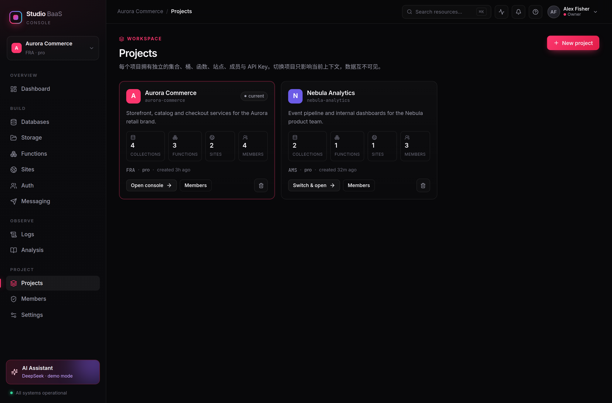

**Projects** 页面把所有项目平铺成卡片，每张卡显示集合 / 函数 / 站点 / 成员数量、地区、状态与创建时间。

- **当前项目**带 `current` 标记，卡片下方按钮为 *Open console*；其他项目是 *Switch & open*。
- 顶栏左上角的项目切换器与这里等价：切换后所有列表、指标、日志、AI 上下文都会跟着换，`localStorage` 记住选择。
- **New project** 会创建项目、自动建一个 `media` 存储桶，并把当前用户设为 owner。

项目隔离不是界面层面的过滤，而是服务端强约束：每个 `/v1` 请求都带 `x-project-id`，`AsyncLocalStorage` 把 `projectId` 注入整条调用链，store 层所有查询都拼上 `WHERE projectId=?`。验证方式：

```bash
curl -s localhost:5174/v1/databases/collections -H 'x-project-id: studio' | jq '.total'          # 4
curl -s localhost:5174/v1/databases/collections -H 'x-project-id: prj_nebula' | jq '.total'     # 2
```

删除项目会级联清理它的集合、文档、文件、函数、站点、消息、API Key、日志、成员、域名、定时任务与仓库绑定；最后一个项目不允许删除。

## 3. Members & RBAC：角色与权限

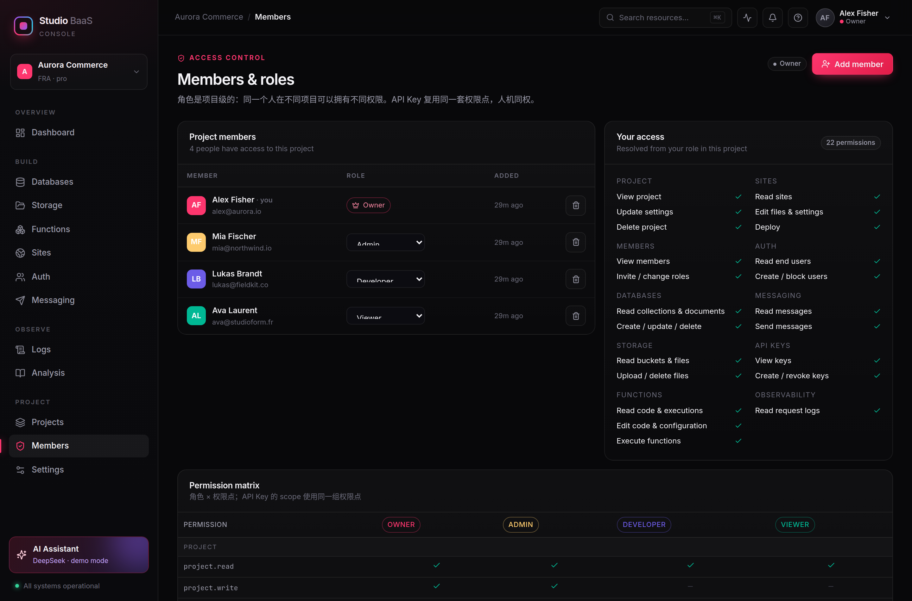

左卡是**成员列表**，右侧是**当前身份解析出的权限**，底部是完整的**权限矩阵**。

- 角色共 4 种：`owner` / `admin` / `developer` / `viewer`，能力从全权到只读递减；
- 权限点共 22 个，按 `project / members / databases / storage / functions / sites / auth / messaging / apiKeys / observability` 分组；
- 邀请成员时填邮箱 + 选角色，`Add member` 立即生效；owner 不能被降级，也不能移除最后一个 owner；
- API Key 的 scope 复用同一批权限点 id，所以「人」和「机器」看到的是同一张矩阵。

服务端每个路由都挂了守卫，越权时返回 403 并说明缺哪一项：

```bash
# viewer 身份尝试写集合
curl -s -i -X POST localhost:5174/v1/databases/collections \
  -H 'content-type: application/json' -H 'x-project-id: studio' -H 'x-studio-act-as: viewer' \
  -d '{"name":"Nope"}' | head -1
# HTTP/1.1 403 Forbidden
# {"code":"forbidden","required":"databases.write","role":"viewer","projectId":"studio"}

# developer 做同样的事则成功
curl -s -o /dev/null -w '%{http_code}\n' -X POST localhost:5174/v1/databases/collections \
  -H 'content-type: application/json' -H 'x-project-id: studio' -H 'x-studio-act-as: developer' \
  -d '{"name":"Allowed"}'   # 201
```

身份解析顺序：`x-api-key` → `x-studio-session` → `x-studio-act-as`（演示用「以角色预览」）→ 默认项目 owner。顶栏头像里的 **View as role** 就是切换 `x-studio-act-as`，切换后界面上的写操作按钮会立刻变灰，横幅提示当前是预览身份。

`x-studio-act-as` 有几条约束，免得变成提权后门：

- **带登录会话时只能往下看**：viewer 带 `x-studio-act-as: owner` 仍按 viewer 判定，写操作照旧 403；
- 无任何凭据时（本地演示）可以声明任意角色，开箱即用的体验不变；
- `STUDIO_ALLOW_ACT_AS=0` 可整体关闭，公网部署建议这样跑。

---

## 4. Dashboard：项目总览

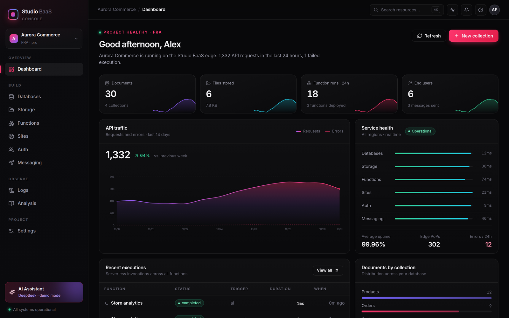

| 区域 | 内容 |
|---|---|
| 顶部状态条 | 项目健康度、区域（FRA）、一句话摘要（24h 请求数 / 失败执行数） |
| 四张指标卡 | 文档数、文件数与占用、24h 函数执行次数、终端用户数，各带 14 天迷你趋势线 |
| API traffic | 14 天请求量（面积图）与错误数（红色虚线），支持悬停查看日粒度数值 |
| Service health | 七个服务的健康状态、P95 延迟、平均可用率、边缘节点数 |
| Recent executions | 最近函数执行：状态、触发方式（ai / manual / schedule）、耗时 |
| Documents by collection | 各集合文档量条形分布 |

数据来自 `GET /v1/metrics`，前端每 30 秒轮询一次；`Recent executions` 来自 `GET /v1/executions`。

---

## 5. Databases：类型化数据建模

### 5.1 集合列表

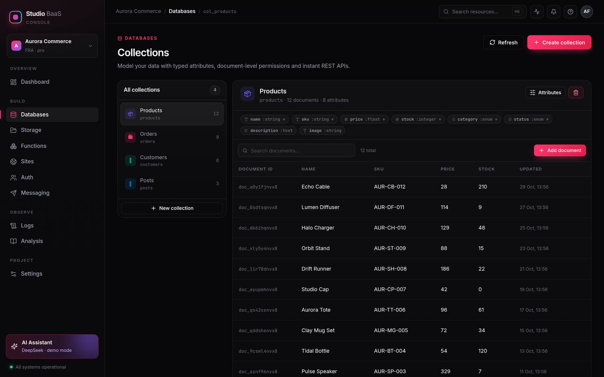

左侧列出所有集合（文档数、属性数、权限摘要），右侧是当前集合的文档表格。演示项目含 `products`、`orders`、`customers`、`posts` 四个集合。

### 5.2 创建集合与属性

点右上角 **New collection** 输入名称（如 `Reviews`），系统会自动派生 `key`（小写复数形式）并跳转到详情页。随后点 **Attributes** 逐个添加字段：

| 类型 | 说明 | 校验 |
|---|---|---|
| `string` | 单行文本，可设长度 | 长度范围 |
| `text` | 多行文本 | — |
| `integer` / `float` | 数字 | 最小值 / 最大值 |
| `boolean` | 布尔 | — |
| `email` / `url` | 语义化字符串 | 格式校验 |
| `datetime` | ISO 时间 | ISO 8601 |
| `enum` | 枚举 | 取值列表（逗号分隔） |

属性可标 **required**（必填）与 **array**（数组）。写入时会按 schema 校验并做类型转换，不合法直接返回 400。

### 5.3 文档 CRUD


- 表格顶部支持**关键词搜索**（对 JSON 全文匹配）、每页条数切换、分页；
- **Add document** 打开抽屉表单，按属性类型渲染不同控件（数字输入、开关、下拉、日期）；
- 编辑时点行尾菜单 → **Edit**，也可切到 **JSON** 模式直接粘贴整个对象；
- 表单会在提交前校验：必填、数字格式、邮箱格式，错误直接标在对应输入框下方（不发起请求）；
- 删除有二次确认弹窗。

对应 API：

```bash
# 列表（支持 limit / offset / search / orderBy / orderType）
curl "http://localhost:5174/v1/databases/collections/col_products/documents?limit=5&search=lamp"

# Appwrite 风格过滤：价格 > 20、按价格升序、只取前 3 条
curl -G "http://localhost:5174/v1/databases/collections/col_products/documents" \
  --data-urlencode 'queries[]=greaterThan("price",20)' \
  --data-urlencode 'queries[]=orderAsc("price")' \
  --data-urlencode 'queries[]=limit(3)'
```

`queries[]` 支持 `equal / notEqual / greaterThan / greaterThanEqual / lessThan /
lessThanEqual / between / contains / startsWith / endsWith / isNull / isNotNull /
orderAsc / orderDesc / limit / offset / select`；属性名会校验，写错或用了未知操作符直接 400。

```bash
# 创建
curl -X POST http://localhost:5174/v1/databases/collections/col_products/documents \
  -H 'content-type: application/json' \
  -d '{"data":{"name":"Studio Lamp","price":89,"stock":12,"category":"Home"}}'
```

> 集合的 `key`（如 `products`）和内部 `id`（如 `col_products`）都可用于路由，云函数里用 `key` 更稳。

### 5.4 文档级权限（`$permissions`）

集合默认由**项目角色**决定能读什么。把集合的 **Document security** 打开后，权限下放到每一行，
规则写在文档的 `permissions` 数组里，语义与 Appwrite 一致：

| 规则 | 含义 |
|---|---|
| `read("any")` / `read("role:all")` | 任何人（含未登录的预览请求） |
| `read("users")` | 任何已登录身份 |
| `read("user:usr_123")` | 指定用户 |
| `read("team:studio/owner")` | 项目 `studio` 里角色为 `owner` 的成员（省略 `/role` 表示任意角色） |
| `update(…)` / `delete(…)` | 分别授予更新 / 删除；`write(…)` 同时覆盖两者 |

判定作用在四处：**列表过滤、单条读取、更新、删除**。没有 read 权限时单条读取返回 **404**
而不是 403，避免用它探测「这条记录存在吗」。演示数据里的 `Notes` 集合就是开着的：
owner 看到 3 条，切到 viewer 只剩 2 条（`Studio retro` 只授给 owner）。

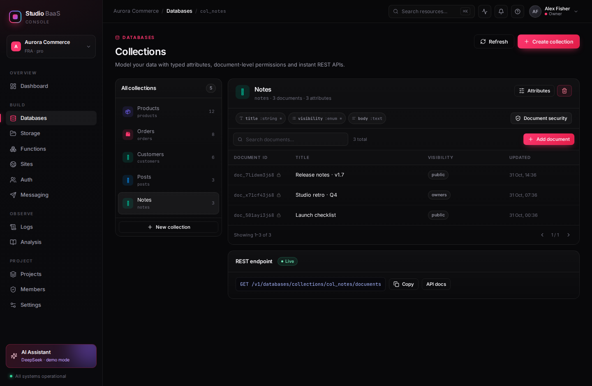
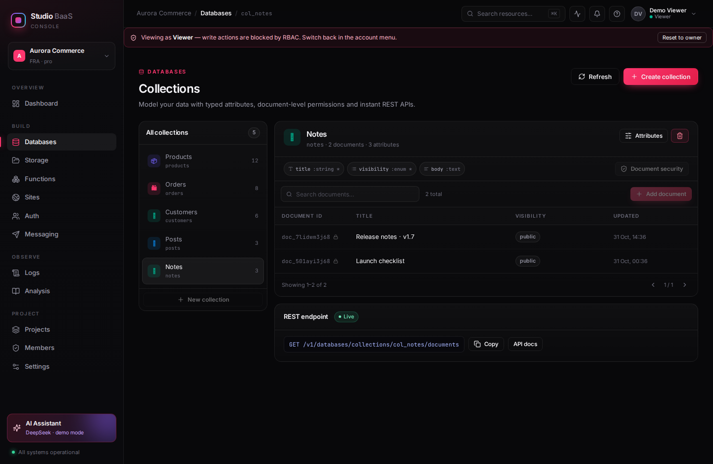

在文档抽屉底部可以直接编辑规则（每行一条），或点 **Only me** 一键生成三条 `user:<我的 id>`：

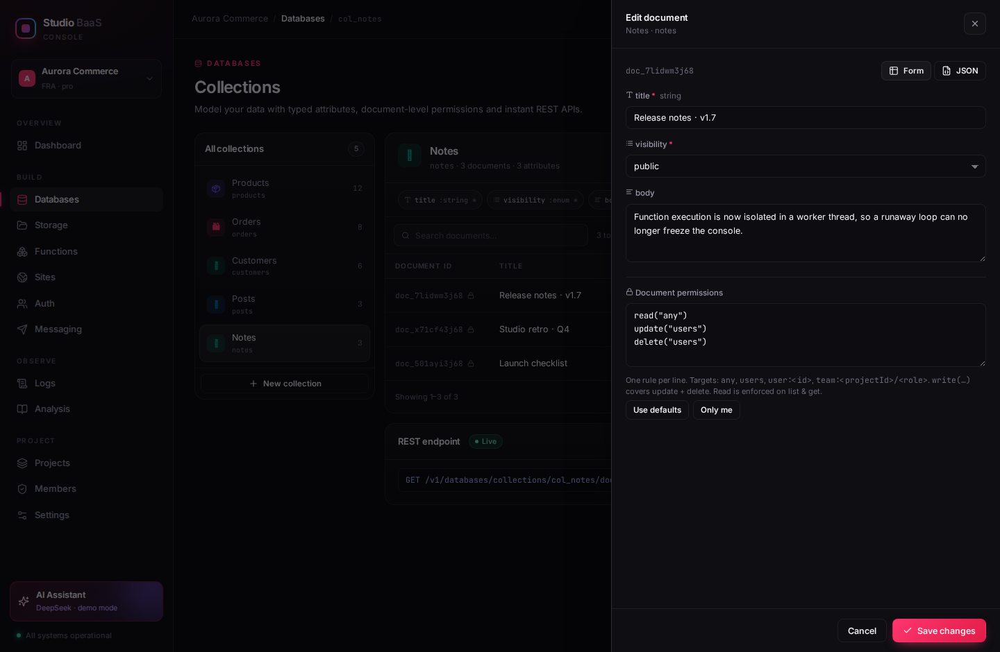

```bash
# 建一条只有 admin 能读的记录
curl -X POST localhost:5174/v1/databases/collections/col_notes/documents \
  -H 'content-type: application/json' -H 'x-project-id: studio' \
  -d '{"data":{"title":"Board memo","visibility":"owners"},
       "permissions":["read(\"team:studio/owner\")","write(\"team:studio/owner\")"]}'

# owner 看得到，developer 看不到（列表里被过滤 / 单条 404）
curl -s localhost:5174/v1/databases/collections/col_notes/documents -H 'x-studio-act-as: developer' | jq '.total'
```

> 实现说明：权限是 JSON 数组里的字符串，SQLite 无法直接按规则过滤，因此开启该开关的集合会
> 先按属性条件取出候选集（上限 5000 行）再在内存里判定。演示规模足够；生产应把 permissions
> 拆成独立表并建索引。API Key 视为服务端身份（与 Appwrite 的 server SDK 一致），跳过行级判定。

### 5.5 批量写入

导入数据走 `POST /v1/databases/collections/:id/documents/bulk`，一次最多 500 行：

```bash
curl -X POST localhost:5174/v1/databases/collections/col_orders/documents/bulk \
  -H 'Content-Type: application/json' \
  -d '{"documents":[{"code":"A-1","status":"paid"},{"code":"A-2","status":"paid"}]}'
```

语义是**全有或全无**：任意一行校验失败，整批回滚，错误信息带下标：

```json
{ "ok": false, "error": "documents[1]: Attribute \"code\" is required" }
```

一个半成品导入比没有导入更难收拾，所以这里不给「部分成功」。AI 助手的 `bulk_create_documents` 用的也是同一条路径。

### 5.6 索引与查询计划

文档存在 `documents.data` 这个 JSON 列里，过滤走 `json_extract(data,'$.字段')`。没有索引时，
每条带条件的查询都要把整个集合读一遍；建了索引之后 SQLite 才会走 `SEARCH`。

集合头部的 **Indexes** 按钮打开两个标签：

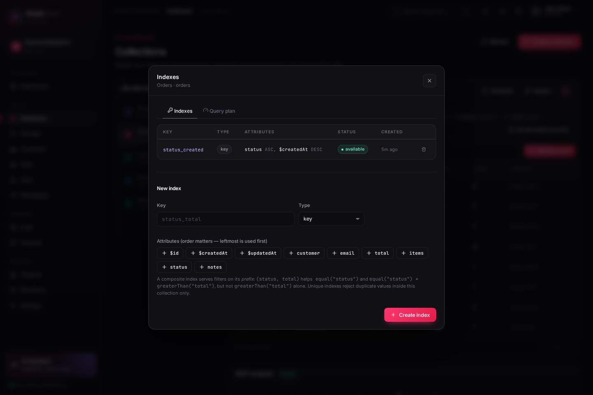

| 能力 | 说明 |
|---|---|
| `key` 索引 | 普通索引，可复合、可指定每列的 `ASC/DESC` |
| `unique` 索引 | 集合内唯一（跨集合不冲突，因为底层是部分索引） |
| 状态 | `available` / `failed`（唯一索引撞上历史重复数据时保留记录 + 错误原因） |

**Query plan 标签**是本功能的验收口径：它把当前查询交给 `EXPLAIN QUERY PLAN`，直接告诉你
走的是索引还是全扫、要不要临时排序。

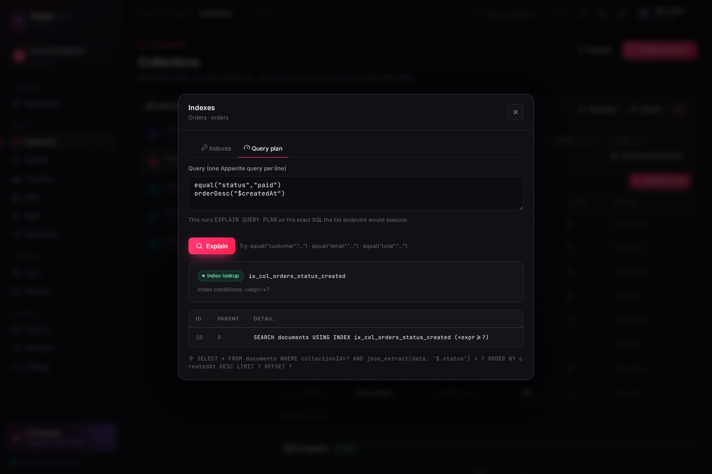

三种结论的含义：

| 结论 | 含义 | 计划长什么样 |
|---|---|---|
| **Index lookup**（绿） | 用上了业务索引，只读需要的行 | `SEARCH … USING INDEX ix_… (<expr>=?)` |
| **Collection scan**（黄） | 只有 `collectionId` 被索引服务，等于集合内全扫 | `USING INDEX idx_docs_col (collectionId=?)` |
| **Full table scan**（红） | 完全没用到索引 | `SCAN documents` |

> 为什么默认会显示 "Collection scan"：`documents` 表上有 `idx_docs_col(collectionId)`，
> 它保证多项目隔离的过滤不退化，但**不减少集合内的扫描量**。所以判断索引有没有用，
> 要看条件里是否出现了业务字段。

复合索引只服务它的**最左前缀**。种子里的 `orders` 建了 `(status, $createdAt)`：

```bash
# 命中索引：status 是最左列
curl -s 'localhost:5174/v1/databases/collections/col_orders/query-plan?queries[]=equal("status","paid")' | jq '{index, narrowed, terms}'
# { "index": "ix_col_orders_status_created", "narrowed": true, "terms": ["<expr>=?"] }

# 单独查 customer：不在索引里 → 集合内全扫
curl -s 'localhost:5174/v1/databases/collections/col_orders/query-plan?queries[]=equal("customer","Acme")' | jq '{index, narrowed}'
# { "index": "idx_docs_col", "narrowed": false }
```

20,000 条文档上的实测（`equal("status") + greaterThan("total") + orderDesc("total")`）：

| | 中位耗时 | p95 | 排序 |
|---|---|---|---|
| 无索引 | 18.2 ms | 22.1 ms | 额外临时 B 树 |
| `(status, total)` | **2.5 ms** | 3.1 ms | 索引本身有序，无临时排序 |

维护规则：

- 删除属性前必须先删掉引用它的索引，否则返回 400（防止索引指向不存在的字段）；
- 删除集合会连同索引一起清理，SQLite 里不留孤儿索引；
- 唯一索引冲突会翻译成 `Index "code" requires unique values`，而不是 SQLite 的原始报错。

---

## 6. Storage：对象存储

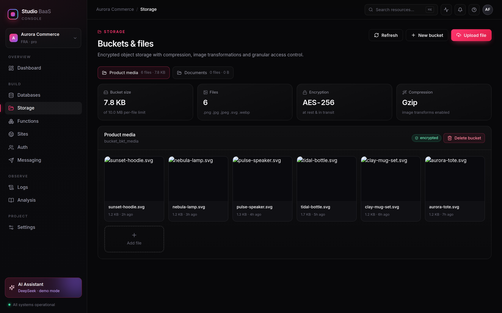

- 多桶结构（演示项目为 `bkt_media`），每桶可配置扩展名白名单与最大体积；
- 支持拖拽或点击上传，上传后立即出现在网格中，图片显示缩略图，其他类型显示图标；
- 文件卡片展示大小、MIME、上传时间，悬停出现**复制直链**与**删除**；
- 直链为 `GET /v1/storage/files/:id/view`，可直接嵌入 `` 或站点页面。

上传为 `multipart/form-data`：

```bash
curl -X POST http://localhost:5174/v1/storage/buckets/bkt_media/files -F "file=@./logo.png"
```

---

## 7. Functions：在线编辑并执行云函数

### 7.1 函数列表

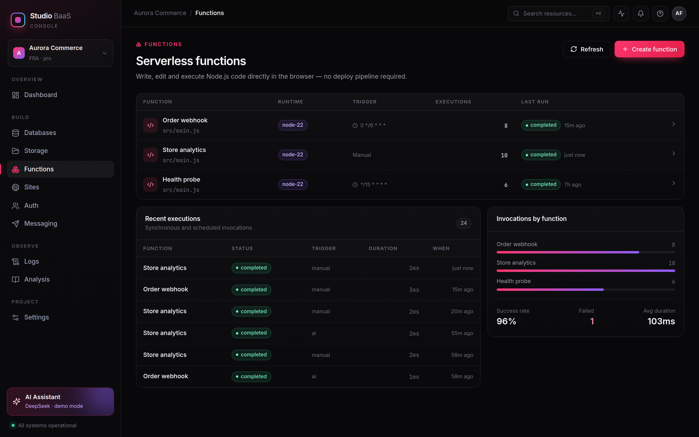

卡片显示运行时、入口文件、调度、近 24h 执行次数与成功率。右侧是**最近执行**表（全部函数的合并视图）和按函数的调用量条形图。

### 7.2 函数详情：写代码 → 保存 → 执行

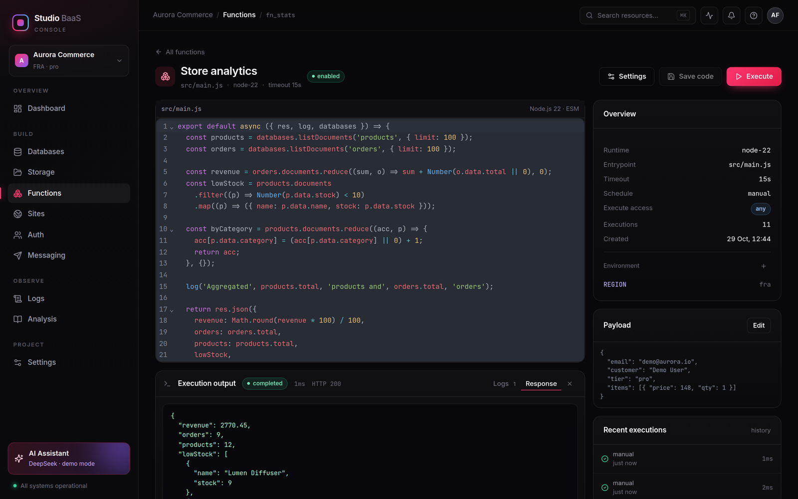

三栏布局：

| 栏位 | 内容 |
|---|---|
| 左 | CodeMirror 6 编辑器，**按运行时切换语言高亮**（JavaScript / Python）、行号、括号匹配；顶部显示入口文件与运行时版本 |
| 右上 | Overview（运行时 / 超时 / 调度 / 执行次数 / 环境变量 / 区域）、Payload 编辑器、执行历史 |
| 右下 | Execution output：**Response / Logs** 双标签，含状态码、耗时、`Completed in XXms` 提示 |

操作流程：

1. 改代码后按 **Save code**（或 `Ctrl/Cmd + S`），保存即产生一个版本；
2. 点 **Execute** 打开运行面板，Payload 是一段任意 JSON，作为 `req.body` 传入；
3. 点 **Run function**，同步执行并回填结果；日志里的 `log()` 输出进入 **Logs** 标签；
4. 右侧 **Recent executions** 可回看历史，点开可复现当次的 payload 与输出。

函数签名（默认导出）：

```js
export default async ({ req, res, log, error, databases, storage, users, env }) => {
  const { email, items = [] } = req.body || {};
  if (!email) { error('email is required'); return res.json({ ok: false }, 400); }
  const total = items.reduce((s, i) => s + i.price * (i.qty || 1), 0);
  const doc = databases.createDocument('orders', { email, total, status: 'pending' });
  log('order created', doc.id, 'total', total);
  return res.json({ ok: true, orderId: doc.id, currency: env.CURRENCY || 'EUR' });
};
```

注入的能力：

| 注入对象 | 方法 |
|---|---|
| `databases` | `listDocuments(key, opts)`、`getDocument`、`createDocument`、`updateDocument`、`deleteDocument` |
| `storage` | `listFiles`、`getFile`、`createFile` |
| `users` | `list()`、`get(id)` |
| `env` | 函数环境变量（在 Overview 的 Environment 里维护） |
| `req` | `body` / `query` / `headers` / `method` / `path` |
| `res` | `json(body, status?)` / `text()` / `send()` / `redirect(url)` |
| `log` / `error` | 写入执行日志 |

沙箱边界：只暴露 `crypto / url / util / querystring / buffer` 白名单模块，**禁用出站网络**，默认 15s 超时（可在 Overview 调整）。ESM 写法会被转译为沙箱可执行的 CommonJS 形式。

Python 函数签名不同——一个接收 `ctx` 的函数，返回即响应体：

```python
def handler(ctx):
    ctx.log("hello", ctx.req.method)
    return ctx.res.json({"ok": True})
```

两种写法的对照见 §7.3。

**执行隔离**：每次执行跑在独立的 `worker_threads` 线程里。超时到点后主线程直接 `terminate()` 掉该线程，
所以下面这种「异步之后再死循环」也只会让这一次执行失败，`/v1/health` 照常 200：

```js
export default async () => { await null; while (true) {} };   // 2s 后被终止，服务不受影响
```

函数里的 `databases.*` 是**同步**调用：worker 通过 `SharedArrayBuffer` + `Atomics.wait` 把请求发给
主线程，主线程在请求所属的项目/身份上下文里执行 SQL 再把结果写回。好处是数据库只有一条写连接、
项目隔离与事件广播都不受影响。代价是单次返回体上限 2MB，且只支持同步 API。

> 受限环境（禁用 `SharedArrayBuffer`）或显式设置 `FUNCTION_ISOLATION=vm` 时会降级为同进程 `vm`：
> 同步死循环仍可被 V8 中断，但异步后的死循环会拖住整个进程——这是降级路径的已知限制。

### 7.3 多语言运行时：Node.js 与 Python

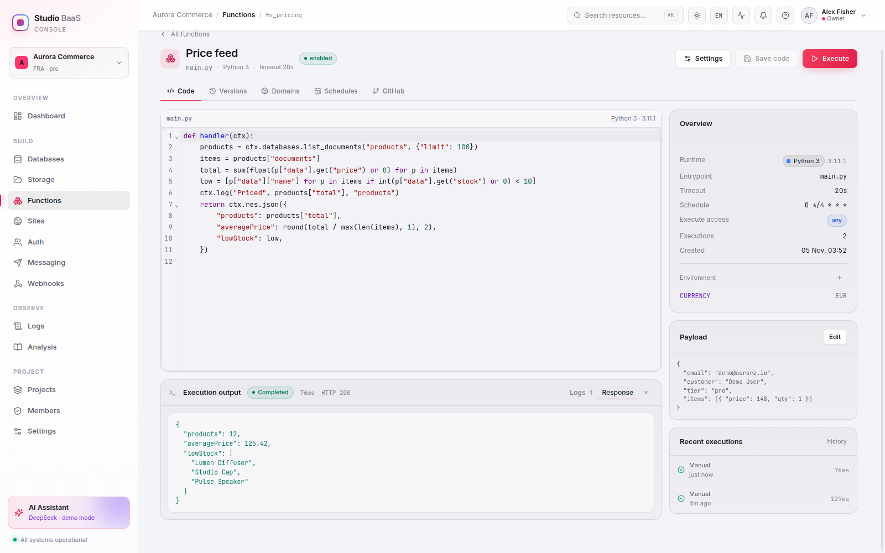

运行时不是一个只读标签，它决定了**代码语言、入口文件、编辑器高亮和执行引擎**。内置两个：

| 运行时 | 语言 | 默认入口 | 执行方式 | 冷启动（本机中位） |
|---|---|---|---|---|
| `node-22` | JavaScript (ESM) | `src/main.js` | worker 线程（`FUNCTION_ISOLATION=vm` 时降级同进程） | ~48ms |
| `python-3` | Python 3 | `main.py` | 子进程 + `studio-bridge/1` 同步 RPC | ~70ms |

**创建时选语言**：Create function 弹窗顶部是语言卡片，显示解释器真实版本与协议；模板下拉和代码预览随之切换。机器上没装 Python 时，卡片会直接标灰，`POST /v1/functions` 也会返回 400，而不是等到执行才报错。

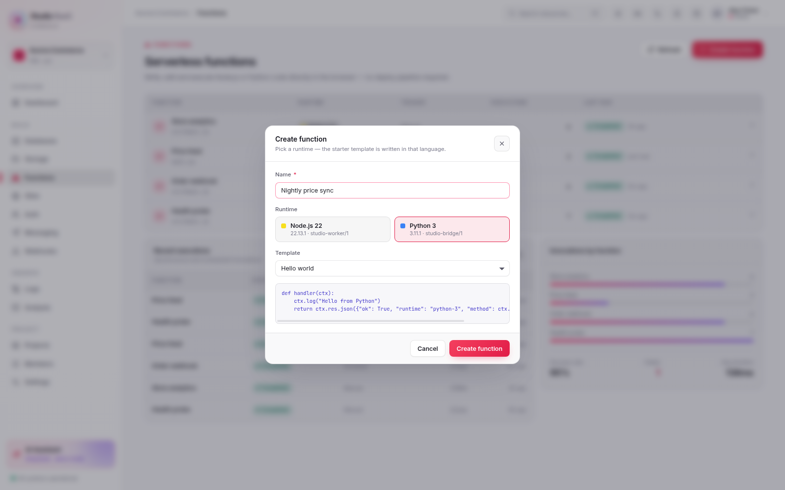

**切换语言**：函数详情 → Settings → Runtime。规则只有一条：

- 手写代码原样保留（切过去跑不通是你的选择，系统不会偷偷改业务逻辑）；
- 如果代码还是内置初始模板，会翻译成新语言的同名模板，并同步入口文件（`src/main.js` ↔ `main.py`）。

**Python 写法**：

```python
import asyncio

async def handler(ctx):
    products = ctx.databases.list_documents("products", {"limit": 100})
    low = [p["data"]["name"] for p in products["documents"] if int(p["data"].get("stock") or 0) < 10]
    ctx.log("priced", products["total"], "products")
    await asyncio.sleep(0)
    return ctx.res.json({"products": products["total"], "lowStock": low})
```

| 注入对象 | 用法 |
|---|---|
| `ctx.databases` | `list_documents` / `get_document` / `create_document` / `update_document` / `delete_document`（也接受 JS 同名写法） |
| `ctx.storage` | `list_files` / `list_buckets` |
| `ctx.users` | `list()` |
| `ctx.req` | `ctx.req.method` 或 `ctx.req["method"]`；`body / query / headers / path` 同理 |
| `ctx.res` | `json(body)` / `text()` / `send()` / `redirect(url)` |
| `ctx.env` | 函数环境变量（同时注入为进程环境变量） |
| `ctx.log` / `ctx.error` | 写入执行日志；`print()` 也走日志，实时回传 |
| `ctx.meta` | `functionId / functionName / projectId` |

**隔离与限制**：

- 每次执行独立进程，超时杀整个进程组；内存上限 256MB（`RLIMIT_AS`）、CPU 上限为超时 +2s、句柄 256；
- `socket` 的出站连接与 DNS 被屏蔽，`urllib` 访问外网会得到 `Outbound network access is disabled in the sandbox`；
- 只能用标准库，不支持运行期 `pip install`；一次执行只有一个入口文件；
- 这些是**进程级**隔离，不是容器。公网多租户部署请换成容器运行时，详见 [函数运行时架构](./函数运行时架构.md)。

`GET /v1/runtimes` 会返回完整清单（含 `availability` 与模板），扩展新语言的步骤也在架构文档里。

### 7.4 Domains：把函数挂到自己的域名

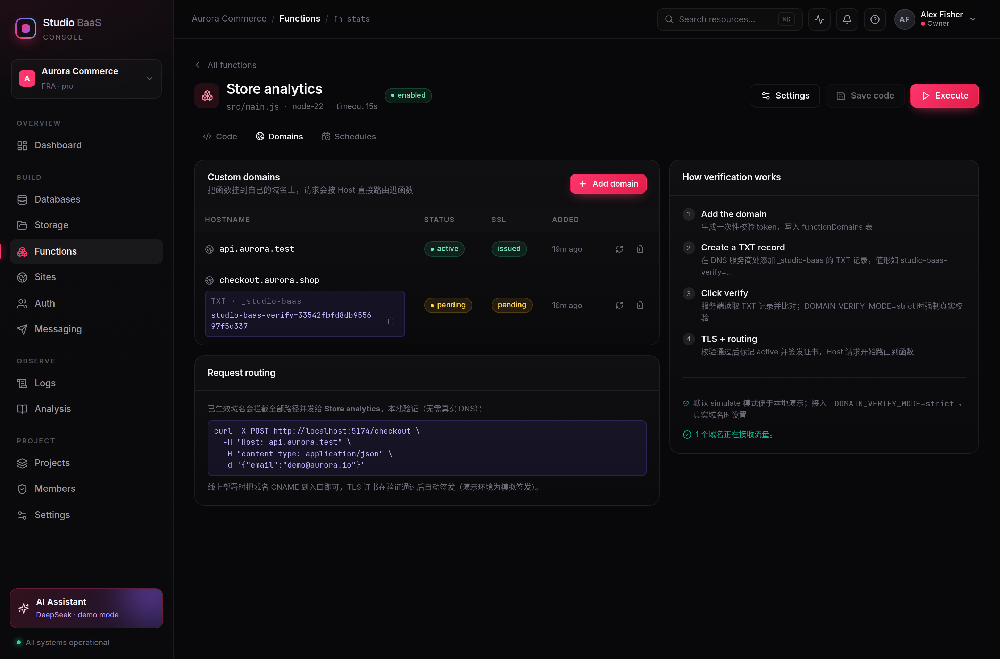

函数详情页顶部有三个标签：**Code / Domains / Schedules / GitHub**。Domains 页里：

1. 点 **Add domain**，输入域名（如 `api.aurora.test`），系统生成一条唯一校验记录；
2. 复制 `studio-baas-verify=<token>`，在域名服务商添加一条 **TXT** 记录；
3. 点 **Verify**：校验通过后状态变 `active`，SSL 变 `issued`；
4. 之后请求按 `Host` 头直接进函数，不需要路径前缀：

```bash
curl -X POST http://localhost:5174/checkout \
  -H 'Host: api.aurora.test' \
  -H 'content-type: application/json' \
  -d '{"email":"demo@aurora.io"}'
```

默认 `DOMAIN_VERIFY_MODE=simulate`（本地无真实 DNS 也能演示）；设为 `strict` 会用 `dns.resolveTxt` 真实查询，查不到就保持 `pending`。`localhost`、`*.trycloudflare.com` 与纯 IP 的 Host 会被跳过，不会被误路由。

### 7.5 Schedules：按 cron 定时执行

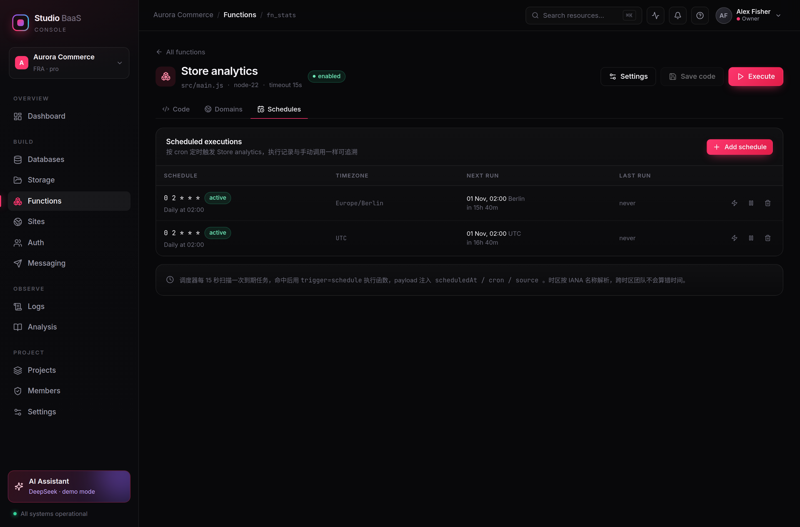

- 支持预设（每 5 分钟 / 每小时 / 每天 2 点 / 每周一 9 点）或手写 5 段表达式：`分 时 日 月 周`，可用 `*`、`1,5`、`9-17`、`*/15`；
- 选时区（IANA，如 `Europe/Berlin`）：`0 2 * * *` 在柏林就是当地凌晨 2 点，夏令时切换也不会漂；
- 输入时**实时预览**接下来三次执行时间，表达式非法会直接标红并给出原因；
- 列表里可以暂停 / 恢复 / 立即执行 / 删除，右侧显示下次执行与上次执行状态；
- 调度器每 15 秒扫描一次到期任务，用 `trigger=schedule` 执行函数，payload 注入 `scheduledAt / cron / source`，执行记录与手动调用完全一致。

### 7.6 GitHub：绑定仓库，push 即部署

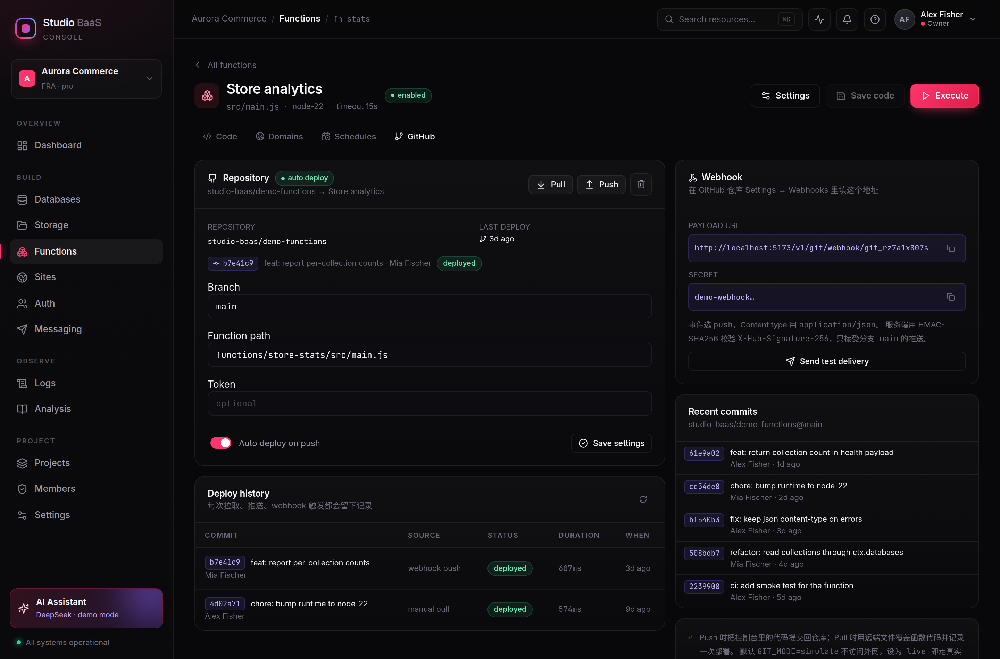

未连接时填三个字段：仓库 `owner/repo`、分支、仓库内的入口文件路径（私有仓库再加一个 `contents:write` 的 token）。连接后：

| 操作 | 行为 |
|---|---|
| **Pull** | 读取远端入口文件 → 覆盖函数代码 → 记录一次部署（含 commit、作者、耗时） |
| **Push** | 把控制台里的代码提交回分支，返回新的 commit |
| **Send test delivery** | 构造一次带正确签名的 push 事件，走完整 webhook 链路 |
| Webhook | 把页面上的 URL 与 secret 填进 GitHub 仓库设置，事件选 `push` |

服务端处理 webhook 的规则：

1. 用 secret 对**原始请求体**做 HMAC-SHA256，与 `X-Hub-Signature-256` 比对，不匹配返回 401；
2. `ping` 事件直接回 200，方便在 GitHub 上一键验证连通性；
3. 只处理 `push`，且 `ref` 必须是配置的分支，否则 202 忽略；
4. `auto deploy` 关闭时不部署，只记录；
5. 部署成功后回写 `lastSha / lastMessage / lastAuthor`，并推一条 SSE 事件刷新界面。

默认 `GIT_MODE=simulate`：不访问外网，commit、部署记录、验签流程全部真实跑通；设为 `GIT_MODE=live` 则调用真实 GitHub REST API（`/repos/:owner/:repo/contents`）。

### 7.7 Versions：保存即部署，可随时回滚

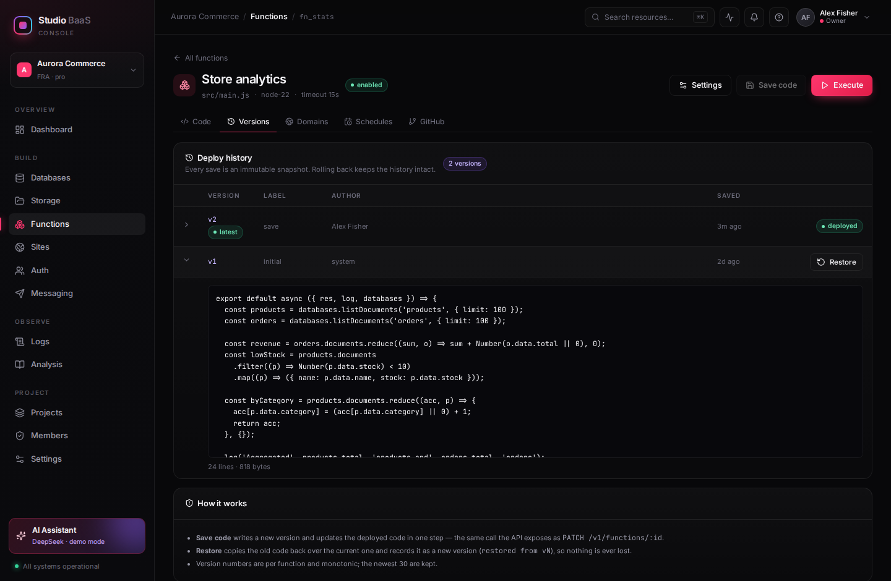

函数详情页的 **Versions** 标签是一份不可变的部署历史：

- 每次 **Save code** 都会生成一个版本（`v1 initial`、`v2 save`…），记录作者与时间；
- 点任意一行展开，直接看**当时的完整代码**（只读，带行数与字节数）；
- 与当前代码不同的版本右侧有 **Restore**：确认后旧代码覆盖当前代码，并**新增**一条
  `restored from vN` 快照——历史只增不改，回滚错了还能再滚回来；
- 每个函数保留最近 30 个版本，版本号按函数单调递增。

```bash
# 版本列表（最新在前）
curl -s localhost:5174/v1/functions/fn_stats/versions | jq '.versions[] | {version, label, createdBy}'

# 回滚：把 v1 的代码重新部署
curl -X POST localhost:5174/v1/functions/fn_stats/versions/fv_fn_stats_1/restore | jq -r '.code' | head -3
```

> 和 GitHub 集成的关系：Pull 会覆盖代码并留快照，Push 只是把当前代码推回仓库；
> 两者都不影响版本历史，所以「push 之前先本地存一版」是安全的。


---

## 8. Sites：在线改代码 + 实时预览

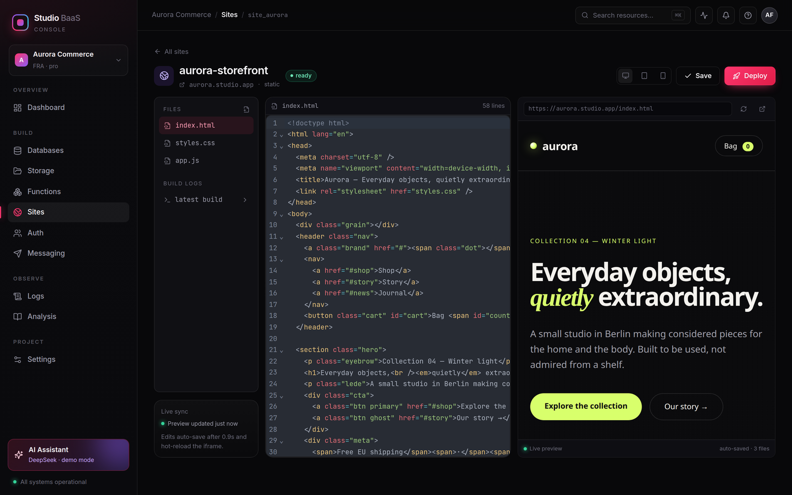

这是本项目最接近「在线 IDE」的页面，三栏：

1. **Files**：站点文件树（`index.html` / `styles.css` / `app.js`…），可新建、重命名、删除；下方是 Build logs；
2. **Editor**：当前文件的 CodeMirror，按扩展名切换 HTML / CSS / JS 高亮；
3. **Live preview**：`<iframe>` 加载 `/v1/sites/:id/preview/index.html`，右上角可切 **桌面 / 平板 / 手机** 三种视口。

行为细节：

- 编辑后 **0.9 秒防抖自动保存**（左下角显示 `auto-saved`），保存后 iframe 自动刷新，无需手动点；
- 站点内的相对路径（`./styles.css`、`./app.js`）会被预览服务按站点根目录解析，多文件站点能正常渲染；
- 点 **Deploy** 触发一次部署，写入构建日志并更新 `status → ready`，演示站点的实时预览地址为 `/v1/sites/site_aurora/preview/index.html`；
- 顶部的 **Save code** 用于立即落盘，避免防抖窗口内关页面丢改动。

> 预览页面会带上 `?t=<timestamp>` 参数绕过浏览器缓存，所以刷新一定是新内容。

---

## 9. Auth：用户体系

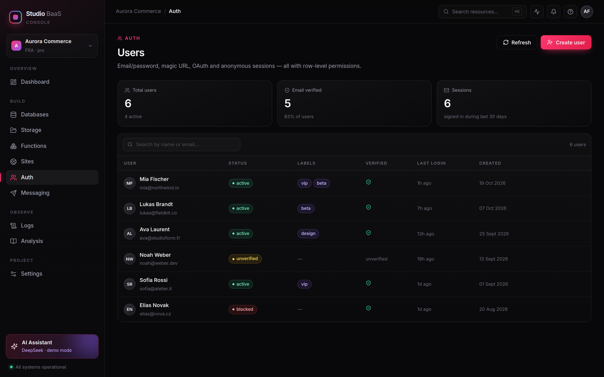

| 能力 | 说明 |
|---|---|
| 用户列表 | 头像（首字母）、姓名、邮箱、状态、标签、创建时间、最后活跃 |
| 状态 | `active` / `unverified` / `blocked`，可一键切换 |
| 创建用户 | 姓名 + 邮箱，系统生成随机密码并返回一次 |
| 密码存储 | `scrypt` + 随机盐，`passwordHash` 从不出现在 API 响应里 |
| 标签 | 逗号分隔，作为权限分组的雏形 |
| 会话 | `POST /v1/auth/sessions` 用邮箱密码换 token，token 存在 `sessions` 表 |

演示数据里的 6 位用户分别覆盖了三种状态，便于观察 UI 差异。

---

## 10. Messaging：消息通道

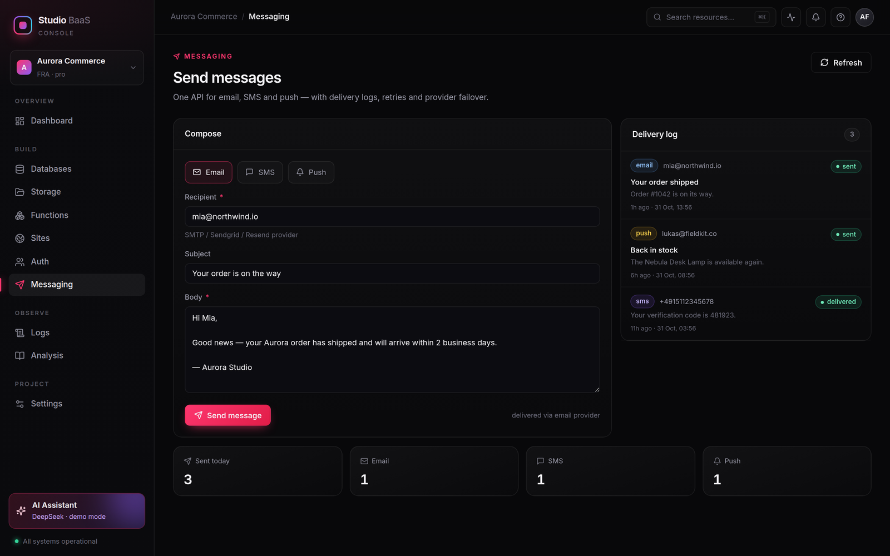

统一的三类通道：**Email / SMS / Push**。

- 左侧是消息列表（通道图标、目标、标题、状态、时间）；
- 右侧是发送表单：选通道 → 填接收方 → 主题 → 正文 → **Send**；
- 每次发送生成一条投递记录，状态 `queued → sent → delivered / failed`，失败会带错误原因；
- API：`POST /v1/messaging/messages`，`GET /v1/messaging/messages` 查历史。

本地实现不会真的发邮件/短信，只落库并模拟投递状态；接入真实网关时替换 `server/src/store.ts` 里的 `sendMessage` 即可。

---

## 11. Logs：请求日志实时流

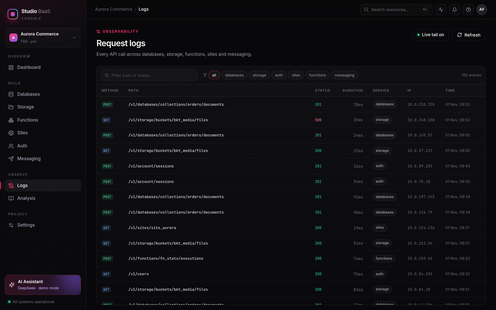

- 表格按时间倒序列出 API 请求：方法、路径、服务归类、状态码、耗时、来源 IP；
- 支持按服务（databases / storage / functions / sites / auth / messaging）与状态码过滤；
- 新日志通过 **SSE**（`GET /v1/realtime`）推送到前端，顶部显示连接状态与实时计数，可用 **Pause** 冻结视图；
- 状态码用颜色区分：2xx 绿、4xx 黄、5xx 红。

这个页面也是排查「AI 到底做了哪些操作」的第一现场——AI 的每次工具调用都会产生真实请求日志。

---

## 12. Analysis：内置分析文档

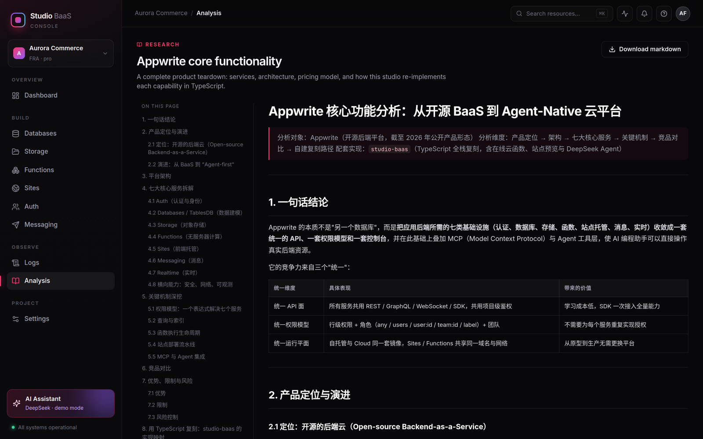

控制台内直接渲染 `docs/Appwrite-核心功能分析.md`：

- 左侧是自动生成的三级目录，随滚动高亮；
- 右侧是 Markdown 正文（自研渲染器，支持表格、代码块、引用）；
- 右上角 **Download markdown** 下载原文（`GET /v1/docs/raw`）。

不想开控制台也可以直接读仓库里的 [Markdown](./Appwrite-核心功能分析.md) 或 [PDF](./Appwrite-核心功能分析.pdf)（12 页排版版）。

---

## 13. Settings：API Key 与 AI 配置

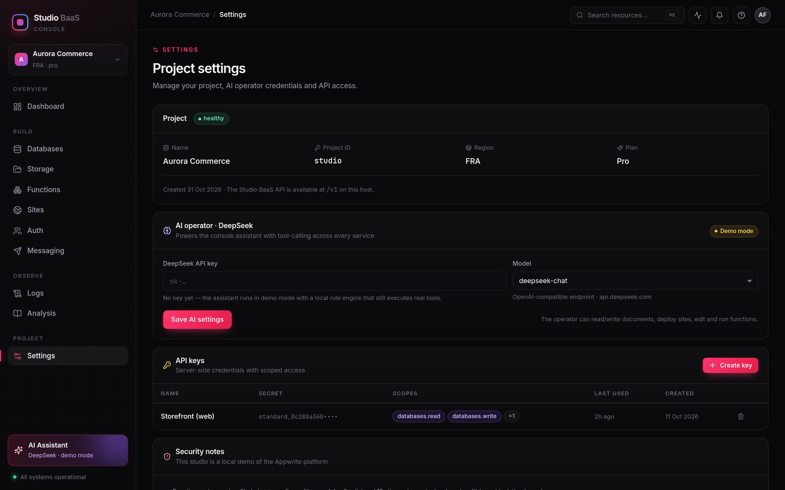

| 区块 | 内容 |
|---|---|
| Project | 项目名、ID、区域、创建时间、API Base（`/v1`） |
| API keys | 创建/吊销 Key，勾选作用域（databases.read / databases.write / functions.execute / storage.write / users.read / sites.deploy…）。**只存 SHA-256 摘要**：明文仅创建时返回一次，列表里永远只有 `standard_ab12••••3f9c` 这样的预览 |
| AI operator | DeepSeek API Key、模型名（默认 `deepseek-chat`）、当前模式（Real / Demo） |
| Danger zone | 重置演示数据 |

DeepSeek Key 也可以走环境变量（优先级更高）：

```bash
export DEEPSEEK_API_KEY=sk-xxxxxxxx
export DEEPSEEK_MODEL=deepseek-chat   # 可选
```

---

## 14. AI Assistant：用自然语言操作整套平台

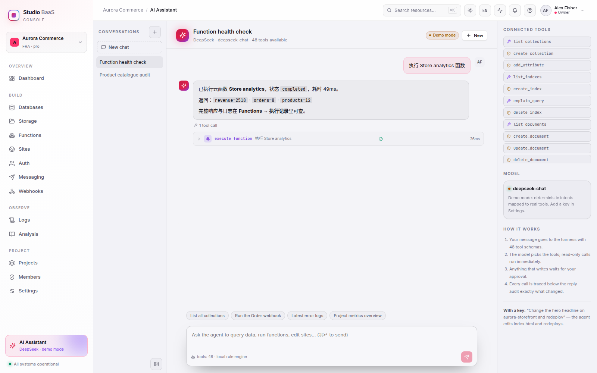

页面分三块：左侧**会话列表**、中间对话流、右侧 **Connected tools**（当前角色可用的工具，写操作带盾牌标记）与 **How it works**。

### 工作方式

1. 你的消息 + 工具 schema + 当前页面与项目摘要一起发给模型；
2. 模型返回 `tool_calls`。**只读工具立即执行**（`list_*` / `get_*` / `explain_*`），写操作先挂起；
3. 挂起的调用以确认卡片呈现：工具名、中文摘要、完整参数。批准后从断点继续，**不会重新请求模型** —— 因此不会给你一个没批准过的计划；
4. 工具结果回填模型，最多 8 轮；
5. 每条回复下方是**工具轨迹**：名称、参数、结果、耗时，可展开审计。

回复是流式的：文字增量到达，工具卡片先转圈再变成耗时与结果，不需要等整段生成完。

### 审批：为什么默认拦下来

28 个工具会改数据：`create_*`、`update_*`、`delete_*`、`deploy_*`、`execute_*`、`send_message`、`restore_*`、`connect_*`。它们默认停在审批关卡上：

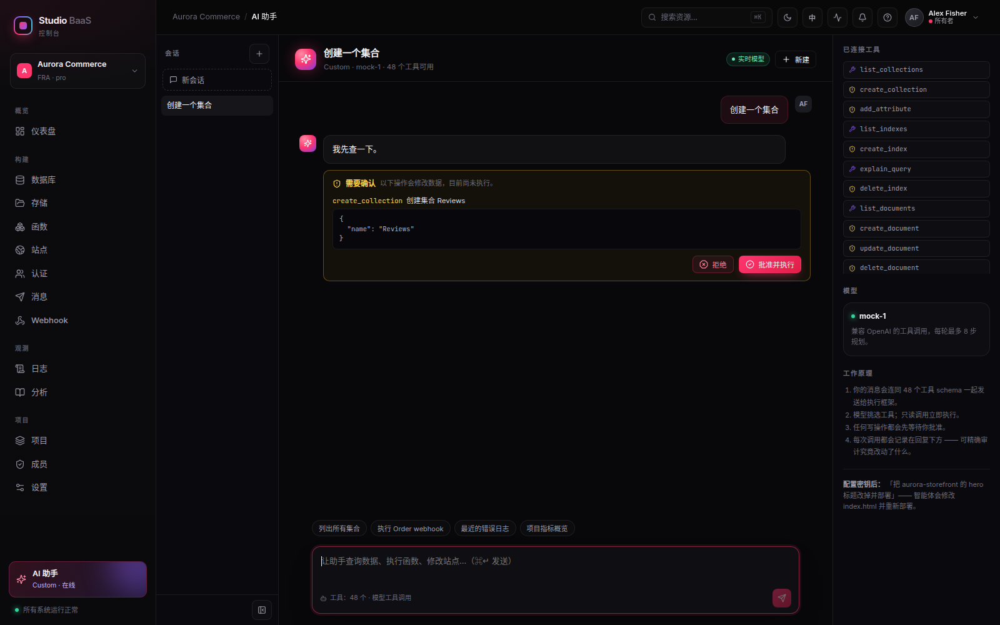

- **批准**：执行，把结果交回模型继续；
- **拒绝**：工具不会执行，模型收到「用户拒绝」后改为询问你想怎么做；
- **超时**：审批令牌 10 分钟有效，过期后重新提问；
- **无人值守**：`AI_APPROVAL=off` 可整体关闭（不建议；CI 或内部脚本才考虑）。

审批只放行**这一次**调用。同一轮里模型再次请求同名工具不会自动通过。

### 权限：AI 不是后门

工具清单按当前角色过滤，`viewer` 根本看不到 `delete_collection`，即使绕过 UI 直接调 `/v1/ai/chat` 也会在服务端被拒：

```text
你（viewer）：删除 Notes 集合
→ 执行时出错：缺少权限 databases.write：当前角色不能执行这个操作。
```

Demo 规则引擎走同一道闸，所以「换个入口就绕开 RBAC」不成立。

### 会话

每个项目一份会话列表，存在 SQLite 里：

- 首次发消息自动建会话，标题取首条消息前 48 字；
- 刷新、切项目、重启服务都还在；
- 悬停可重命名/删除；
- 打开页面默认进入最近一次会话。

### 工具覆盖（48 个）

| 分类 | 工具 |
|---|---|
| 数据库 | `list_collections`、`create_collection`、`delete_collection`、`add_attribute`、`list_documents`、`get_document`、`create_document`、`update_document`、`delete_document`、`bulk_create_documents`、`list_indexes`、`create_index`、`delete_index`、`explain_query` |
| 存储 | `list_buckets`、`create_bucket`、`list_files`、`delete_file` |
| 函数 | `list_functions`、`get_function`、`create_function`、`update_function_code`、`execute_function`、`list_executions`、`list_function_versions`、`restore_function_version` |
| 域名 / 定时 | `list_schedules`、`create_schedule` |
| GitHub | `connect_function_repo`、`deploy_function_from_git` |
| 站点 | `list_sites`、`update_site_file`、`deploy_site` |
| 用户 / 消息 | `list_users`、`create_user`、`delete_user`、`send_message`、`list_messages` |
| 项目 / 成员 | `list_projects`、`create_project`、`list_members`、`add_member` |
| Webhook | `list_webhooks`、`create_webhook`、`delete_webhook` |
| 可观测 | `get_metrics`、`get_logs`、`create_api_key` |

### 可以这样说

- 「给我一个项目概览，说明文档、用户和函数的情况」
- 「执行 Store analytics 函数并解释结果」
- 「创建一个叫 Reviews 的集合」（创建后可以直接让它加字段）
- 「给 orders 的 status 字段建索引」——它会用 `(status, $createdAt DESC)`，同时服务过滤与排序
- 「把 aurora-storefront 的 hero 标题改掉并部署」
- 「显示最近的错误日志并给出修复建议」
- 「邀请 alice@example.com 作为 developer」

### Demo 模式

没有配置 Key 时，本地规则引擎解析中文意图并**照样执行真实工具调用**，右上角标 `Demo mode`。它覆盖常见动词（创建/列出/删除集合、建索引、跑函数、查日志、看指标、部署站点、加定时），但不会多步规划。配置 Key 后由模型自主决策，工具与审批边界完全一致。

### 换模型

**Settings → AI operator** 里选服务商（DeepSeek / OpenAI / Ollama / Custom），填模型名与 Base URL。也可以走环境变量（优先级更高）：

```bash
AI_PROVIDER=ollama AI_MODEL=qwen2.5-coder AI_BASE_URL=http://127.0.0.1:11434/v1 pnpm dev
```

只要端点兼容 OpenAI 的 `/chat/completions` 与 `tools`，就能用。

---

## 15. Webhooks：把事件推出去

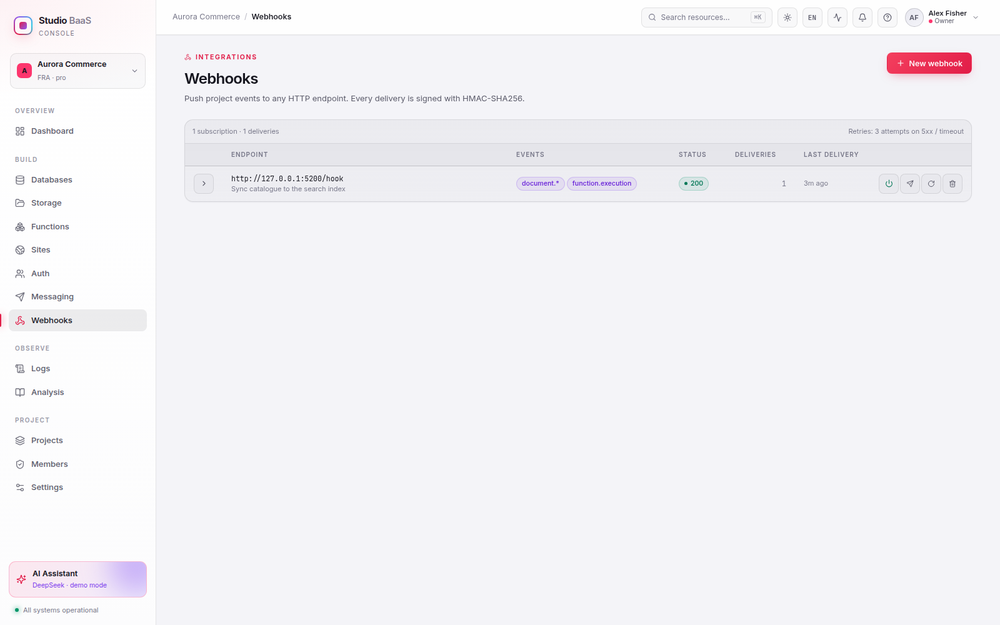

控制台内部有事件总线，Webhooks 把它接到外部：订阅 `document.created`，写入一行的瞬间就会向你的端点发一次 POST。

### 建一条订阅

填写 **Endpoint URL** 与事件。事件支持三档写法：

| 写法 | 含义 |
|---|---|
| `*` | 全部事件（默认） |
| `document.*` | 该资源的所有动作 |
| `document.create` | 精确到动作 |

可用资源：`collection`、`document`、`file`、`function`、`execution`、`site`、`user`、`message`、`schedule`、`domain`、`git`、`member`、`project`、`ai`。

创建后弹窗展示**签名密钥**，只显示这一次 —— 列表接口不会返回它。丢了就点「轮换密钥」。

### 校验签名

每个请求带：

```text
X-Studio-Event: document.create
X-Studio-Signature: t=1793641295,v1=0d1cc4a130d7…
```

签名内容是 `"{t}.{原始请求体}"` 的 HMAC-SHA256（十六进制），密钥是创建时那个 secret。先比对 `t` 与当前时间（防重放），再比对摘要（常量时间比较）：

```js
const [t, v1] = header.split(',').map((s) => s.split('=')[1]);
const expected = crypto.createHmac('sha256', secret).update(`${t}.${rawBody}`).digest('hex');
if (!crypto.timingSafeEqual(Buffer.from(expected), Buffer.from(v1))) return res.status(401).end();
```

### 投递语义

- 5 秒超时；
- 5xx 与超时最多重试 3 次（0ms / 250ms / 1s）；
- 4xx（除 429）不重试 —— 参数错了重试也没用；
- 每次投递都记状态码、耗时、尝试次数，展开行即可看到；
- 投递是**旁路**的：端点慢不会拖慢 API 响应。

「发送测试事件」会发一条 `ping`，用来验证端点与验签逻辑。

---

## 16. SSO：OIDC / OAuth2 / CAS / LDAP

企业里没人愿意再记一个密码。这一节把控制台接到已有的账号体系：**OIDC**（Keycloak / Entra ID / Auth0 / Okta / Google）、**OAuth 2.0**、**CAS 2.0/3.0**、**LDAP / Active Directory** 四种协议，共用同一个登录页和同一条会话落库路径。

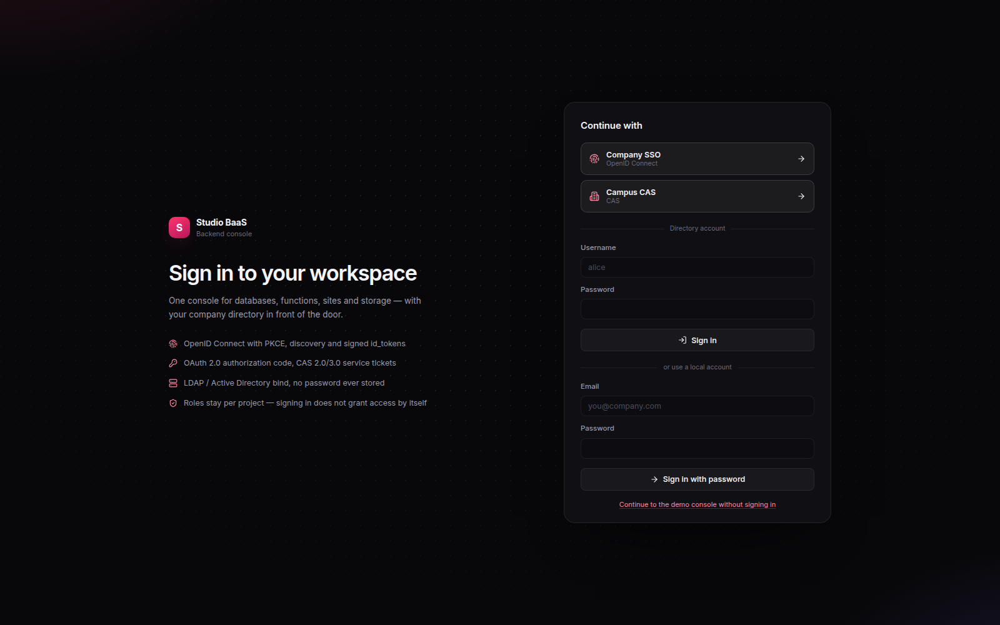

### 16.1 先理解三件事

1. **身份源是项目级的**：A 项目开了 OIDC，不影响 B 项目。登录页只列出「已启用」的源。
2. **登录 ≠ 授权**：SSO 只证明「你是谁」。进项目之后拿什么角色，仍由 `members` 表决定；首次登录可以按 `defaultRole` 自动入组（默认 `viewer`，也可以选「不加入项目」）。
3. **密码登录不会被关掉**：本地账号、SSO 账号并存。同一个人两种方式都能进，落到同一个用户上（前提是邮箱已验证，见 16.6）。

### 16.2 配置 OIDC

**Settings → 认证 → 添加身份源 → OpenID Connect**，或者直接调接口：

```bash
curl -X POST localhost:5174/v1/auth/sso/config \
  -H 'content-type: application/json' \
  -d '{
    "type": "oidc",
    "name": "Company SSO",
    "defaultRole": "developer",
    "allowedDomains": ["corp.example"],
    "config": {
      "issuer": "https://keycloak.corp.example/realms/acme",
      "clientId": "studio-console",
      "clientSecret": "从 IdP 复制",
      "scopes": ["openid", "email", "profile"]
    }
  }'
```

| 字段 | 说明 |
|---|---|
| `issuer` | 只填到 realm 一层，不要带 `/.well-known/...`。端点与 JWKS 会自动发现 |
| `clientId` / `clientSecret` | IdP 里注册的客户端；密钥加密入库，接口只回 `••••1234` |
| `scopes` | `openid` 必需，`email` `profile` 用来拿姓名和邮箱 |
| `defaultRole` | 首次登录自动加入项目时的角色：`viewer` / `developer` / `admin` / 空（不加入） |
| `allowedDomains` | 只允许这些邮箱域登录，空表示不限制 |

**别忘了在 IdP 里登记回调地址**（每个身份源一个）：

```
http://localhost:5174/v1/auth/sso/<providerId>/callback
```

`providerId` 在列表里（`idp_…`）。走反向代理或隧道时，用 `STUDIO_API_URL` 告诉服务端对外地址，否则 `redirect_uri` 会拼成内网地址、IdP 直接拒绝。

保存后点 **测试连接**：它会真的去取一次 discovery 文档，端点写错当场报错，不用等到有人点登录。

### 16.3 OAuth 2.0

没有 `id_token`，所以端点要手填三个：授权、Token、Userinfo。资料从 `userinfo` 取，字段名默认 `email` / `name`，对不上可以改 `emailField` / `nameField`。

```json
{
  "type": "oauth2", "name": "GitHub-like",
  "config": {
    "clientId": "…", "clientSecret": "…",
    "authorizeUrl": "https://idp.example/oauth/authorize",
    "tokenUrl": "https://idp.example/oauth/token",
    "userinfoUrl": "https://idp.example/api/user",
    "scopes": ["read:user", "user:email"],
    "emailField": "email", "nameField": "login", "idField": "id"
  }
}
```

默认带 PKCE，`client_secret` 放表单（`tokenAuth: "post"`）；只认 Basic 的服务端改成 `"tokenAuth": "basic"`。

### 16.4 CAS

```json
{
  "type": "cas", "name": "Campus CAS",
  "config": { "serverUrl": "https://cas.example.edu/cas", "version": "3",
              "emailAttribute": "mail", "nameAttribute": "displayName" }
}
```

- 登录跳 `{serverUrl}/login?service=…`，票据在 `{serverUrl}/serviceValidate`（3.0 走 `/p3/serviceValidate`）校验。
- **`service` 里带了 `state`**：CAS 协议本身没有 CSRF 参数，把它挂在 service 查询串上，服务端会原样带回来；校验票据时用的必须是同一个字符串。
- 3.0 会返回 `<cas:attributes>`，按属性名取姓名与邮箱；2.0 只有用户名，此时邮箱合成成 `用户名@CAS域名`（够用，不完美——要真实邮箱就上 3.0）。

### 16.5 LDAP / Active Directory

```json
{
  "type": "ldap", "name": "Corporate AD", "defaultRole": "developer",
  "config": {
    "url": "ldaps://dc01.corp.example:636",
    "baseDn": "ou=people,dc=corp,dc=example",
    "bindDn": "cn=svc-studio,ou=services,dc=corp,dc=example",
    "bindPassword": "…",
    "userFilter": "(sAMAccountName={{username}})",
    "attrEmail": "mail", "attrName": "displayName", "attrUsername": "sAMAccountName"
  }
}
```

登录分两步，第二步不能省：

1. 用服务账号（没配就匿名）在 `baseDn` 下按 `userFilter` 搜人 —— 拿到 DN；
2. **用这个 DN + 用户刚输入的密码重新 bind** —— 这才是真正的密码校验。搜索结果只说明「目录里有这个人」。

几个容易踩的点：

- **空密码必须拒绝**：按 RFC 4513，空密码的 simple bind 会退化成匿名绑定并返回成功。服务端在发请求前就拦掉了。
- **用户名要转义**：`*` 会变通配符、`)` 能改写过滤器结构。`{{username}}` 会被替换成 RFC 4515 转义后的值，`(uid=*)(objectClass=*)` 这类输入搜不到东西。
- Active Directory 记得用 `sAMAccountName` 而不是 `uid`；`ldaps://` 或者 `ldap://` + STARTTLS 二选一，自签证书可以勾「跳过证书校验」（仅限内网）。
- 结果码对照：`49` 密码错、`32` baseDn 写错、`50` 服务账号没搜索权限。

### 16.6 账号合并的规则

| 情况 | 结果 |
|---|---|
| 这个 `(身份源, subject)` 之前登录过 | 直接进对应账号 |
| 新 subject，邮箱在本地不存在 | 建一个新用户（无密码，`labels: ["sso", <type>]`） |
| 新 subject，邮箱已存在，且 IdP 说 `email_verified: true` | 并入已有账号（多个登录方式指向同一人） |
| 新 subject，邮箱已存在，但邮箱**未验证** | 拒绝，提示先用密码登录再绑定 |

最后一行是关键：否则任何人拿一个 `admin@corp.example` 的账号在任意 IdP 上登录，就能接管本地管理员。CAS / LDAP 因为是管理员显式配置的可信目录，默认按已验证处理（可在身份源上关掉 `trustEmail`）。

### 16.7 本地跑一遍

仓库里带了一个**零依赖的演示 IdP**（OIDC + OAuth2 + CAS），签的是真 RS256，PKCE 和 `redirect_uri` 也真校验：

```bash
node scripts/fixtures/demo-idp.mjs
# Demo IdP (OIDC + OAuth2 + CAS) on http://127.0.0.1:5199
#   Issuer http://127.0.0.1:5199 · Client ID studio · Secret e2e-client-secret-9f2a
```

然后在 Settings 里加一个 OIDC 源（Issuer 填 `http://127.0.0.1:5199`），打开 `/login` 点它 —— 会用 `alice@corp.example` 进来。

LDAP 需要一个真目录。用 ldapjs 起一个参考实现（它同时充当「独立实现」的对照，证明我们手写的 BER 编解码不是自说自话）：

```bash
mkdir -p /tmp/ldapref && cd /tmp/ldapref && npm i ldapjs
cp <repo>/scripts/fixtures/ldap-server.mjs .
node ldap-server.mjs          # ldap://127.0.0.1:1389，用户 alice/alice-pass
```

自动化验收（40 条断言，含重放 state、伪造签名、错误 nonce、未验证邮箱、开放重定向、LDAP 空密码）：

```bash
node scripts/sso-e2e.mjs                              # OIDC / OAuth2 / CAS
LDAP_TEST_URL=ldap://127.0.0.1:1389 node scripts/sso-e2e.mjs   # 加上 LDAP
```

### 16.8 排错

| 现象 | 原因 |
|---|---|
| 设置里看不到「认证」卡片 | 当前角色不是 admin/owner（`sso.read` 只给 admin 及以上） |
| 登录后回到 `/login` 并提示 state 过期 | 回调地址被访问了两次（刷新、或代理重试）；重新点一次登录即可 |
| IdP 报 `redirect_uri_mismatch` | 回调地址没登记，或反代后协议/端口变了（设 `STUDIO_API_URL`） |
| `Invalid id_token signature` | JWKS 缓存了旧密钥时会自动重取一次；仍然失败多半是 issuer 配错、指向了另一个租户 |
| `id_token nonce mismatch` | 同一个 code 被用了两次，或 IdP 没回传 nonce |
| `email already exists` | 见 16.6 最后一行：先去 IdP 把邮箱标记为已验证 |
| LDAP `invalid credentials` | 密码错、或服务账号密码错（测试连接能区分：测试连接失败 = 服务账号问题） |

> 想在这些登录方式之上再加一层？见 [17. 二次验证](#17-二次验证totppasskey-与强制策略) —— 策略按角色或按人生效，与身份源无关。

---

## 17. 二次验证：TOTP、Passkey 与强制策略

密码是一次性证据：它可能被撞库、被贴在工单里、被同事看到。二次验证要的是**第二个独立的证据**——你手机上的一个 App，或你设备上的一枚私钥。

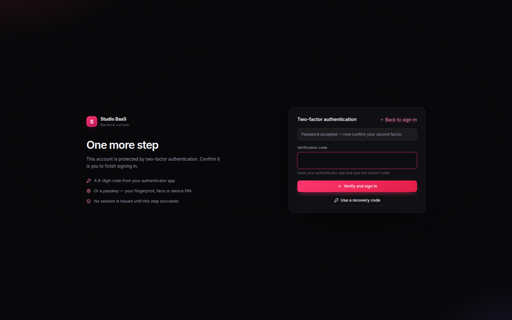

### 17.1 三种方式

| 方式 | 适合谁 | 原理 |
|---|---|---|
| **认证器 App（TOTP）** | 所有人，兼容性最好 | RFC 6238：`HMAC-SHA1(密钥, 时间步)` 取 6 位，每 30 秒换一次 |
| **Passkey** | 有指纹/面容/设备 PIN 的人 | WebAuthn：设备生成密钥对，私钥永不离开设备，登录时对挑战签名 |
| **恢复码** | 手机丢了、设备换了 | 绑定成功时发的 10 个一次性码，每个只能用一次 |

三者可以并存。一个人可以同时绑「iPhone 上的 1Password」和「MacBook 的 Touch ID」，登录时任选一个。

### 17.2 绑定第一个因素

**Settings → 二次验证**，点右上角的 **认证器 App** 或 **Passkey**。

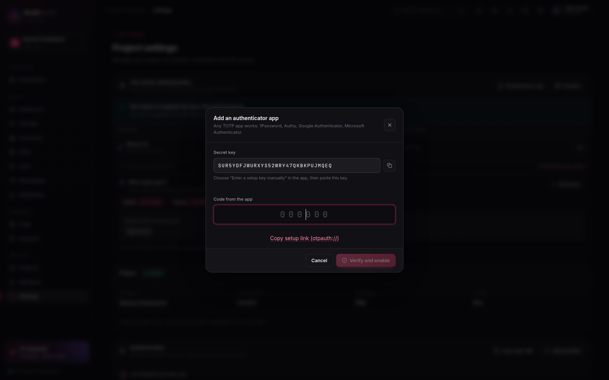

**认证器 App**：弹窗会给出一个 base32 密钥。在 App 里选「手动输入设置密钥」粘贴进去，然后把它显示的 6 位码填回来——这一步是必需的，否则「加了一个从头到尾没验证过的密钥」等于给账号上了把打不开的锁。

**Passkey**：填个名字（例如「MacBook 触控 ID」），点继续，浏览器会弹指纹/面容/PIN。私钥留在设备的安全芯片里，服务端只拿到公钥。

绑定成功后立刻显示 10 个恢复码——**只显示这一次**，下载或抄下来。丢了手机就靠它进来。

### 17.3 配置强制策略

**Settings → 二次验证 → 谁必须使用 → 编辑策略**（需要 admin 及以上）。

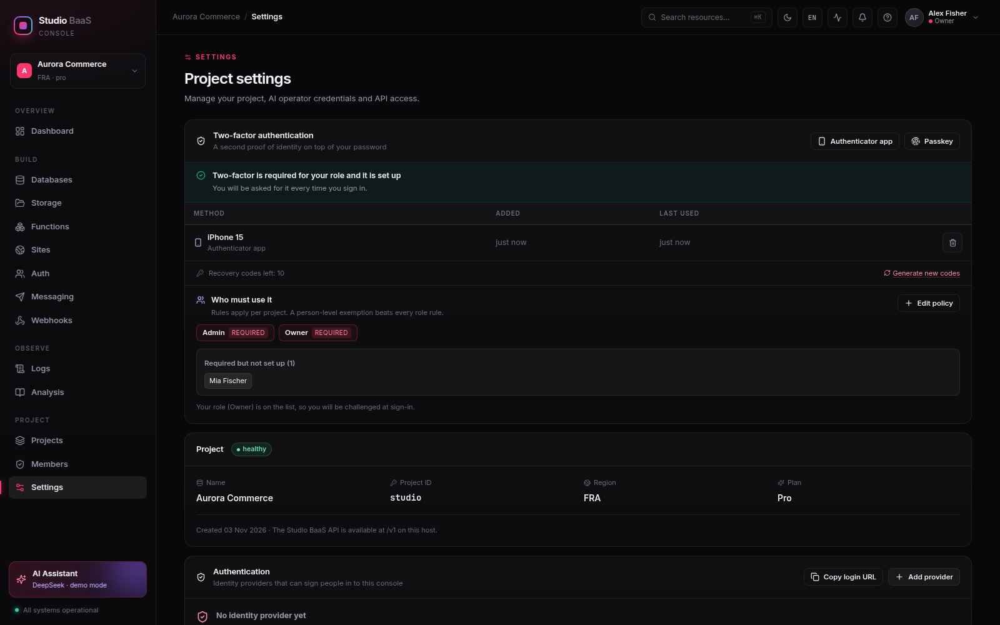

规则只有两种作用域、两种模式：

| 规则 | 含义 |
|---|---|
| 角色 + 强制 | 这个项目里该角色的所有人，登录时必须过第二因素 |
| 角色 + 豁免 | 该角色里默认不强制（给「实习生除外」这类场景留口子） |
| 个人 + 强制 | 精确到某个人，优先级高于角色 |
| 个人 + 豁免 | 这个人永远不被要求——CI 机器人、共享账号 |

**优先级**：个人豁免 > 个人强制 > 项目内角色豁免 > 项目内角色强制 > 默认关闭。显式豁免放在最前面是有意的：管理员给某个账号开了豁免，结果被另一个项目里同名的角色规则盖回去，这种「设置不生效」最难排查。

策略是**项目级**的，但登录是全局的：只要你在任意一个项目里命中了强制规则，登录时就会被要求。判定会遍历你所属的全部项目。

界面下方还会列出「要求开启但还没设置」的名单——这是合规缺口，不是错误。

### 17.4 强制注册：被要求开但还没开

这是所有二次验证系统都会遇到的引导问题：要求这个人必须开，可他一个因素都没绑。直接拒绝登录，他就永远进不来，也就永远没机会绑。

这里走的是**受限会话**：

1. 密码（或 SSO）验证通过后，服务端发一个 `assurance=pending` 的会话，同时返回 `mfaEnrollmentRequired: true`；
2. 前端把他送到安全设置页并滚到卡片上；
3. 这个会话只能访问 `/v1/auth/mfa/*` 和 `/v1/auth/me`，其他接口一律 `403 mfa_required`；
4. 绑定成功后**还需要重新登录一次**。

第 4 步不是多余的：如果绑完立刻升级权限，「拿到密码的攻击者」自己绑一个认证器就等于绕过了第二因素。要求重新登录，至少让新设备从「绑定」到「能用」之间多一次完整的凭据校验。

> 这个窗口无法通过技术手段完全消除——首次绑定必然要信任「有密码的人」。生产环境建议配合绑定通知、管理员审核或审计日志。

### 17.5 登录时的样子

第一因素通过后，页面切到第二步：

- 输入认证器 App 里的 6 位码；
- 或点 **Use a passkey instead**，用指纹/面容验证；
- 或点 **Use a recovery code**，粘贴恢复码。

这一步的凭据是一张 **5 分钟、一次性、32 字节随机**的挑战票据，不是会话。刷新页面挑战还在（可以从 `/v1/auth/mfa/challenge/:id` 读回「有哪些方式」），但读不到账号信息。

### 17.6 安全细节

| 关卡 | 做法 |
|---|---|
| 验证码重放 | 记录上次成功的 TOTP 时间步，同一个步长（含窗口重叠）的码不能用第二次 |
| 在线爆破 | 每张挑战只有 5 次机会，用完即废；另有 IP 级限流 |
| 时钟漂移 | 允许 ±1 个步长（30 秒）；再放宽就等于把码的有效期拉长到 90 秒 |
| Passkey 克隆 | 校验 `signCount` 必须递增；两台设备同一把密钥签名会露馅 |
| 中间人 / 钓鱼 | WebAuthn 校验 `origin` 与 `rpId`，签名只对特定域名有效 |
| 密钥泄露 | TOTP secret 用 AES-256-GCM 加密落库，接口永不回传 |
| 删除用户 | 连带删除其认证器、恢复码与未完成挑战，避免 id 回收后继承旧密钥 |
| IP 访问 | WebAuthn 规范禁止 IP 作为 `rpId`，用 IP 打开时 Passkey 按钮不显示，服务端也会拒绝 |

### 17.7 本地跑一遍

TOTP 与策略：

```bash
node scripts/mfa-e2e.mjs
# 50 条断言：RFC 6238 官方向量、绑定、重放、恢复码、爆破上限、强制注册、策略优先级
```

Passkey 需要真实浏览器。脚本用 Chromium 的**虚拟认证器**（CDP `WebAuthn` 域）：

```bash
node scripts/passkey-e2e.mjs
# 19 条断言：真浏览器生成 P-256 密钥、真 attestation、真签名；含篡改签名被拒
```

> 用 `http://localhost:5173` 而不是 `127.0.0.1` —— WebAuthn 的 `rpId` 必须是域名。

### 17.8 排错

| 现象 | 原因 |
|---|---|
| 设置里没有二次验证卡片 | 当前不是登录状态（演示身份也能用，但 API Key 不行） |
| 添加 Passkey 没反应 | 不是 HTTPS、不是 localhost，或浏览器不支持 WebAuthn |
| `That code is not valid` | 手机时钟偏了超过 30 秒；或这个码刚用过（同一时间步只能用一次） |
| 绑完还是提示要验证 | 受限会话必须重新登录一次才会升级 |
| 登录后哪都点不动 | 被策略要求但没绑因素——只能待在设置页，绑定后重新登录 |
| 恢复码提示「已用完」 | 10 个都用掉了；重新生成会在设置页覆盖旧的一批 |

---

## 18. 外观与语言：亮/暗主题与中英文

控制台右上角有两个开关：太阳/月亮图标切主题，`EN`/`中` 切界面语言。两者都写进 `localStorage`，刷新页面、切换项目都不会丢。

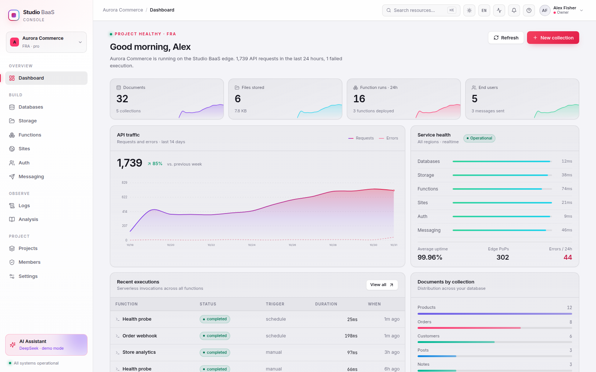

- **主题**：亮色 / 暗色 / 跟随系统三档。默认「跟随系统」，首次访问按操作系统偏好决定；首屏由 `index.html` 里的内联脚本提前写好 `data-theme`，不会先白闪一下再变暗。想固定某一种，去 **Settings → Appearance** 显式选。
- **语言**：英文 / 简体中文。英文原文即词条 key（`t('New project')`），中文词条按页面拆在 `web/src/lib/i18n/zh.*.ts`，缺译时回退英文而不是露出裸 key。
- **只翻界面**：文档内容、字段名、代码、API 路径、日志原文、scope id 一律不动；日期格式与相对时间（`3m ago` ↔ `3 分钟前`）跟着语言走。
- **一套变量撑两个主题**：`--bg` / `--panel` / `--line` / `--w1…w8` 等语义变量在 `:root` 与 `:root[data-theme="light"]` 各给一套值，组件里不写死颜色；CodeMirror 编辑器在亮色下自动换浅色高亮。

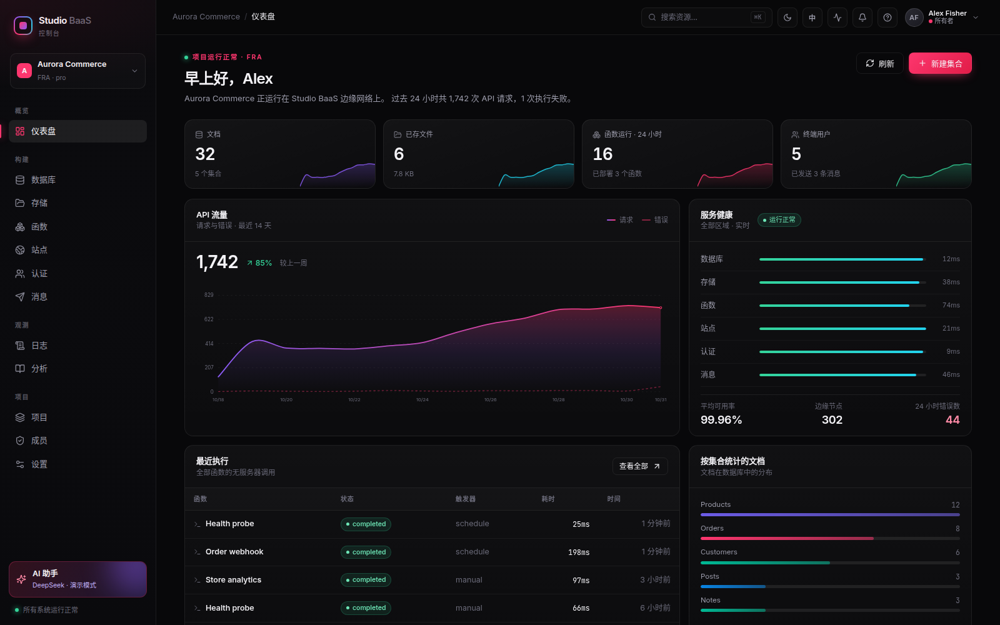

中文界面的数据页（表头、日期、按钮全部本地化，字段名保持原样）：

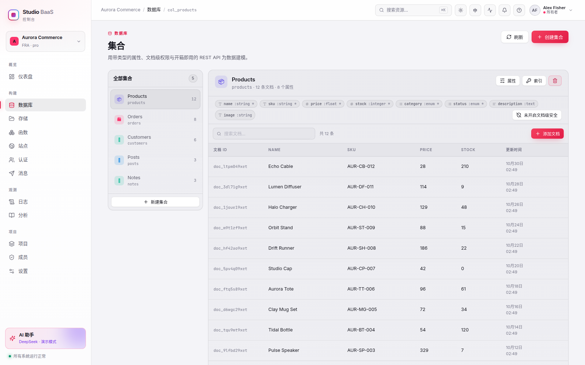

主题与语言也可以在这里固定，而不是每次点顶栏：

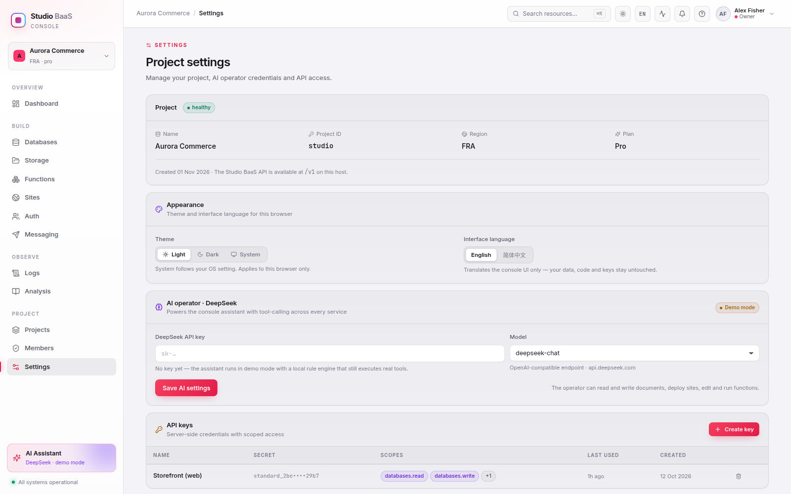

`pnpm i18n:check` 会扫描全部 `t('…')` 调用，缺中文词条、占位符对不上、跨页面译文互相冲突都会让 CI 失败。

---

## 19. 公网访问（Cloudflare Tunnel）

```bash
# 安装（一次即可）
curl -L https://github.com/cloudflare/cloudflared/releases/latest/download/cloudflared-linux-amd64 \
  -o /usr/local/bin/cloudflared && chmod +x /usr/local/bin/cloudflared

# 开发模式 + 隧道
pnpm tunnel

# 生产模式（单端口）+ 隧道
pnpm tunnel:prod
```

脚本会打印形如 `https://xxx-yyy-zzz.trycloudflare.com` 的地址，并写入 `.tunnel/url.txt`。实测穿透正常的部分：页面渲染、HMR（`wss://`）、API 代理、函数执行、站点预览 iframe、SSE 日志流。

注意：

- 临时域名**每次重启都变**，需要固定域名请建命名隧道（`cloudflared tunnel create` + 自有域名 CNAME）；
- 隧道是公开可访问的，演示完 `Ctrl+C` 关闭；
- Vite 已设置 `allowedHosts: true`，否则会被 host 校验拦成 403。

---

## 20. 常见问题

| 现象 | 原因与处理 |
|---|---|
| 启动报 `better-sqlite3` 原生模块错误 | `pnpm rebuild better-sqlite3`，或确认 Node 22 与构建工具链（`gcc` / `make` / `python3`）就绪 |
| 5173 打开空白、控制台报代理错误 | 后端没起来；先看 `pnpm --filter server dev` 是否监听 5174 |
| 函数执行返回 `timeout` | 默认 15s；在函数 Overview 里调大，或检查是否有死循环 |
| 函数里 `require` 报错 | 沙箱只允许 `crypto / url / util / querystring / buffer`，其余模块需内联实现 |
| 站点预览 404 | 站点必须有 `index.html`；文件路径区分大小写 |
| AI 一直回「演示模式」 | 未配置 `DEEPSEEK_API_KEY`，或 Settings 里的 Key 未保存成功 |
| 数据想重来 | 停服务，删除 `server/data/`，重启自动重新播种 |
| 界面一半中文一半英文 | 该页面新增了 `t('…')` 但没补词条；`pnpm i18n:check` 会列出具体是哪个文件哪一句 |

---

## 附：目录结构

```
studio-baas/
├── docs/                      # 分析文档、使用指南、截图
│   └── screenshots/           # 本文所有截图（1600px 宽）
├── scripts/tunnel.sh          # 开发服务 + Cloudflare Tunnel 一键启动
├── server/
│   └── src/
│       ├── index.ts           # Express 路由与静态托管
│       ├── db.ts              # SQLite schema
│       ├── store.ts           # 业务服务层
│       ├── context.ts         # 请求级 projectId + principal
│       ├── projects.ts        # 项目与级联删除
│       ├── rbac.ts            # 角色与 22 个权限点
│       ├── members.ts         # 成员关系
│       ├── auth.ts            # 身份解析 + guard()
│       ├── domains.ts         # 自定义域名与 DNS 校验
│       ├── cron.ts            # 手写 cron 解析 + 时区
│       ├── schedules.ts       # 定时任务与调度器
│       ├── git.ts             # GitHub 绑定 / pull / push / webhook
│       ├── functions/         # 多语言运行时：注册表 / JS worker / 子进程桥 / Python harness
│       ├── ai.ts              # DeepSeek harness + 37 个工具
│       ├── seed.ts            # 演示数据
│       └── events.ts          # SSE 事件总线
└── web/
    └── src/
        ├── pages/             # 各功能页面
        ├── components/        # Layout / CodeEditor / Charts / UI
        └── lib/               # Markdown 渲染、格式化
```
